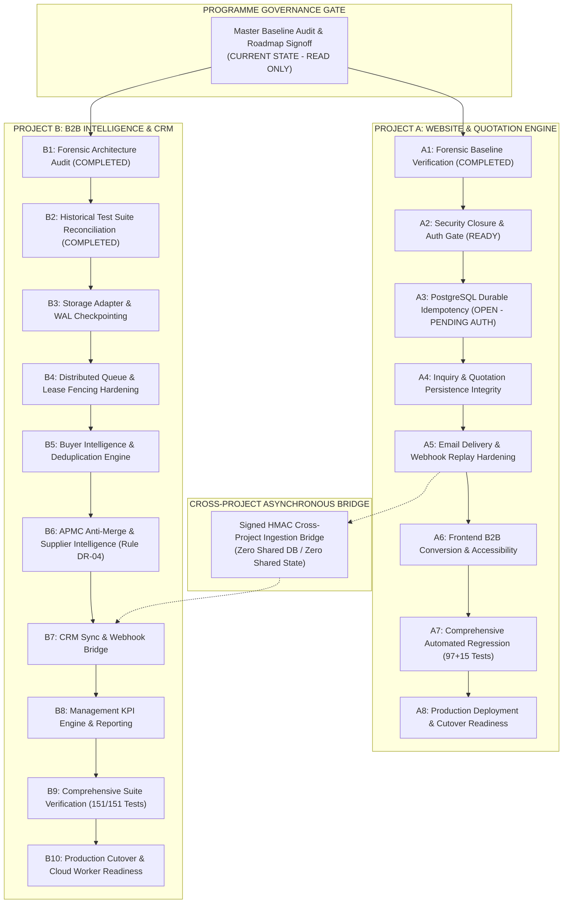

# MASTER IMPLEMENTATION ROADMAP — VERSION 2.1
## AVANI AGRO FOODS TWO-PROJECT TECHNICAL STABILISATION PROGRAMME

**Author:** Principal Software Architect & Multi-Project Programme Lead  
**Owner:** Sachin Shinde  
**Business:** AVANI AGRO FOODS (Latur, Maharashtra, India)  
**Date:** 2026-11-17  
**Current Governance Lock Status:** STRICT READ-ONLY | ZERO MODIFICATIONS PERMITTED  
**Master Status:** `PROJECT_A=BASELINE_AUDIT_PENDING` | `PROJECT_B=BASELINE_AUDIT_PENDING`  

---

## 1. Executive Summary & Programme Charter

This Master Implementation Roadmap governs the controlled, evidence-based technical stabilisation, security hardening, and production readiness of two strictly decoupled software assets owned by Avani Agro Foods:

1. **PROJECT A (`AVANI AGRO FOODS WEBSITE ENGINE`):**
   - **Exact Root:** `C:\Users\ALPHA-1\Downloads\21MAY2026\SACHIN SHINDE DOCUMENTS\DEVELOPEMENT TOOLS\2-AVANI AGRO FOODS LATUR 2026`
   - **Stack:** React 18, Vite 5, Tailwind CSS, Vercel Serverless (Node.js), Supabase PostgreSQL, Upstash Redis/KV, Resend.
   - **Role:** B2B export storefront, RFQ submission engine, dynamic quotation generator, and buyer inquiry portal.
   - **Current Git State:** Branch `main` | Commit `2f1a548` (In sync with `origin/main`). Tracked modified files: `api/save-lead.js` and `api/_lib/supabaseClient.js` (Phase 1 Package 3F.133 remediation intact).
2. **PROJECT B (`AVANI_AGRO_INTELLIGENCE`):**
   - **Exact Root:** `C:\Users\ALPHA-1\Downloads\21MAY2026\SACHIN SHINDE DOCUMENTS\DEVELOPEMENT TOOLS\AVANI_AGRO_INTELLIGENCE`
   - **Stack:** Python 3.14, SQLite WAL (local) / libSQL HTTP (Turso cloud), B2B entity resolution, APMC anti-merge graph (Rule DR-04), 7-step cold outreach sequence engine, CAS lease-fenced job queue, executive KPI engine.
   - **Role:** Market intelligence engine, statutory business verification (PAN, GSTIN, IEC, FSSAI), CRM synchronization, outbound outreach automation (currently locked), and commercial analytics.
   - **Current Git State:** Branch `main` | Commit `6067997` (In sync with `origin/main`). Working tree 100% clean.

---

## 2. Programme Governance & Non-Negotiable Locks

The following governance locks are active across both repositories and cannot be superseded by any historical report:

```ini
GLOBAL_OUTREACH_STOP=1
OUTREACH_AUTHORIZED=0
PILOT_AUTHORIZED=0
IMPLEMENTATION_AUTHORIZED=0
DATABASE_MIGRATION_AUTHORIZED=0
TEST_EXECUTION_AUTHORIZED=0
DEPENDENCY_INSTALLATION_AUTHORIZED=0
DEPLOYMENT_AUTHORIZED=0
GIT_COMMIT_AUTHORIZED=0
GIT_PUSH_AUTHORIZED=0
EXTERNAL_COMMUNICATION_AUTHORIZED=0
LIVE_DEPLOYMENT_AUTHORIZED=0
PHASE_3_AUTHORIZED=0
```

### Strict Project Separation Directives
- **Zero Monorepo Merging:** Project A and Project B must never be combined into a single Git repository.
- **Zero Shared Databases:** Supabase PostgreSQL (Project A) and SQLite/Turso libSQL (Project B) must remain physically separate data stores.
- **Zero Credential Sharing:** Project A credentials (Vercel, Supabase, Upstash, Resend) must never be injected into Project B, and Project B credentials (Turso, HubSpot, Sender.net, Svix) must never be accessible to Project A.
- **Zero Co-Mingled Deployments:** Each project maintains independent deployment pipelines, runbooks, and rollback procedures.

---

## 3. High-Level Multi-Phase Master Roadmap



---

## 4. Phase-by-Phase Roadmap Matrix

| Phase ID | Scope Summary | Key Dependencies | Primary Deliverable | Risk Tier | Current Status |
| :--- | :--- | :--- | :--- | :---: | :---: |
| **A1** | Project A Forensic Baseline Audit & Git Inspection | Master Prompt v2.1 | `PROJECT_A_GIT_BASELINE_VERIFICATION.md` | Tier 1 (Low) | **VERIFIED COMPLETE** |
| **B1** | Project B Forensic Baseline Audit & Code Inspection | Master Prompt v2.1 | `PROJECT_B_BASELINE_AND_IMPLEMENTATION_PLAN.md` | Tier 1 (Low) | **VERIFIED COMPLETE** |
| **B2** | Historical Test Reconciliation (53 vs 70 vs 151) | Master Prompt v2.1 | `PROJECT_B_TEST_RECONCILIATION.md` | Tier 1 (Low) | **VERIFIED COMPLETE** |
| **A2** | Security Architecture Review & Scope Lock | Phase A1 completion | `PACKAGE_3F_136_REMEDIATION_PLAN.md` | Tier 2 (Medium) | **READY FOR OWNER REVIEW** |
| **A3** | Durable Idempotency Ledger Implementation | Owner Authorization Gate A3 | Migration: `20261117_inquiry_idempotency_ledger.sql` | Tier 3 (High) | `OPEN (UNAUTHORIZED)` |
| **B3 / B4** | Storage Adapter & Queue Fencing Verification | Owner Authorization Gate B3/B4 | Lease Fencing & WAL Checkpoint Proof | Tier 2 (Medium) | `PENDING AUTHORIZATION` |
| **A4 / A5** | Public Ingestion Hardening & Webhook Recovery | Phase A3 completion | AST/Mocks Execution Reports | Tier 2 (Medium) | `PENDING AUTHORIZATION` |
| **B5 / B6** | Rule DR-04 & Intelligence Graph Hardening | Phase B3/B4 completion | APMC Anti-Merge Test Evidence | Tier 2 (Medium) | `PENDING AUTHORIZATION` |
| **B7 / B8** | CRM & KPI Engine Verification | Phase B5/B6 completion | Offline KPI Generation Verification | Tier 1 (Low) | `PENDING AUTHORIZATION` |
| **INT** | Signed Asynchronous Event Bridge Specification | Phases A5 & B7 | `CROSS_PROJECT_INTEGRATION_SPECIFICATION.md` | Tier 2 (Medium) | **SPECIFIED (UNIMPLEMENTED)** |
| **A7 / B9** | Full Automated Regression Execution (97+15 / 151) | Owner Test Authorizations | Test Execution Logs & Defect Registers | Tier 2 (Medium) | `PENDING AUTHORIZATION` |
| **A8 / B10**| Production Cutover & Release Verification | Owner Deploy Authorizations | Production Readiness Gate Audits | Tier 3 (High) | `PENDING AUTHORIZATION` |

---

## 5. Implementation Authorization Protocol

Under the strict change-control rules of Master Execution Prompt v2.1:
1. **No Automatic Chaining:** Completing one phase never automatically starts the next.
2. **Explicit Owner Authorization Package:** Each phase requires a formal pre-implementation submission covering exact files, SQL diffs, test double plans, rollback scripts, and acceptance criteria.
3. **Execution Separation:** Authorizing implementation does not authorize test execution, database migration, or deployment. Each action requires isolated owner consent.
