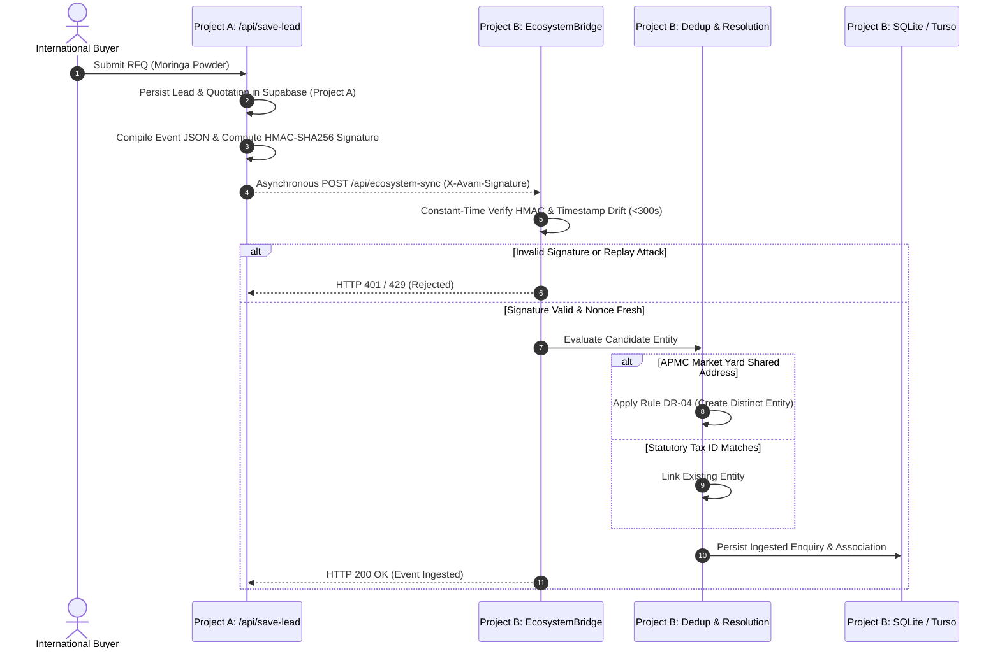

# CROSS-PROJECT INTEGRATION READINESS REPORT
## AVANI AGRO FOODS: PROJECT A $\leftrightarrow$ PROJECT B INTERFACE

**Author:** Principal Enterprise Architect & Distributed Systems Engineer  
**Date:** 2026-11-17  
**Reference:** Master Execution Prompt v3.0, Part 11 (Phase 7)  
**Location:** `08_CROSS_PROJECT/CROSS_PROJECT_INTEGRATION_READINESS_REPORT.md`  
**Current State:** SPECIFIED & LOCALLY TESTED | LIVE SYNCHRONIZATION LOCKED (`OUTREACH_AUTHORIZED=0`)  

---

## 1. Technical Justification for Future Integration

Project A (`AVANI AGRO FOODS WEBSITE ENGINE`) and Project B (`AVANI_AGRO_INTELLIGENCE`) serve complementary commercial functions:
- **Project A:** Public export storefront, dynamic quotation engine, and buyer RFQ intake.
- **Project B:** Statutory supplier/buyer verification, entity resolution graph, APMC anti-merge tracking, and commercial pipeline analytics.

**Architectural Decision:** An automated, asynchronous signed integration bridge is technically justified to eliminate manual data re-entry while maintaining absolute database decoupling.

---

## 2. Integration Boundary Architecture & Security Protocol

---

## 3. Mandatory Non-Integration Controls

Until explicit owner authorization for live cross-project synchronization is granted:
1. `GLOBAL_OUTREACH_STOP=1` unconditionally blocks Project B from initiating automated marketing sequences on ingested Project A inquiries.
2. Ingested inquiries in Project B are marked `VerificationStatus.UNVERIFIED` pending manual operator compliance review.
3. Zero direct database-to-database connections are permitted.
