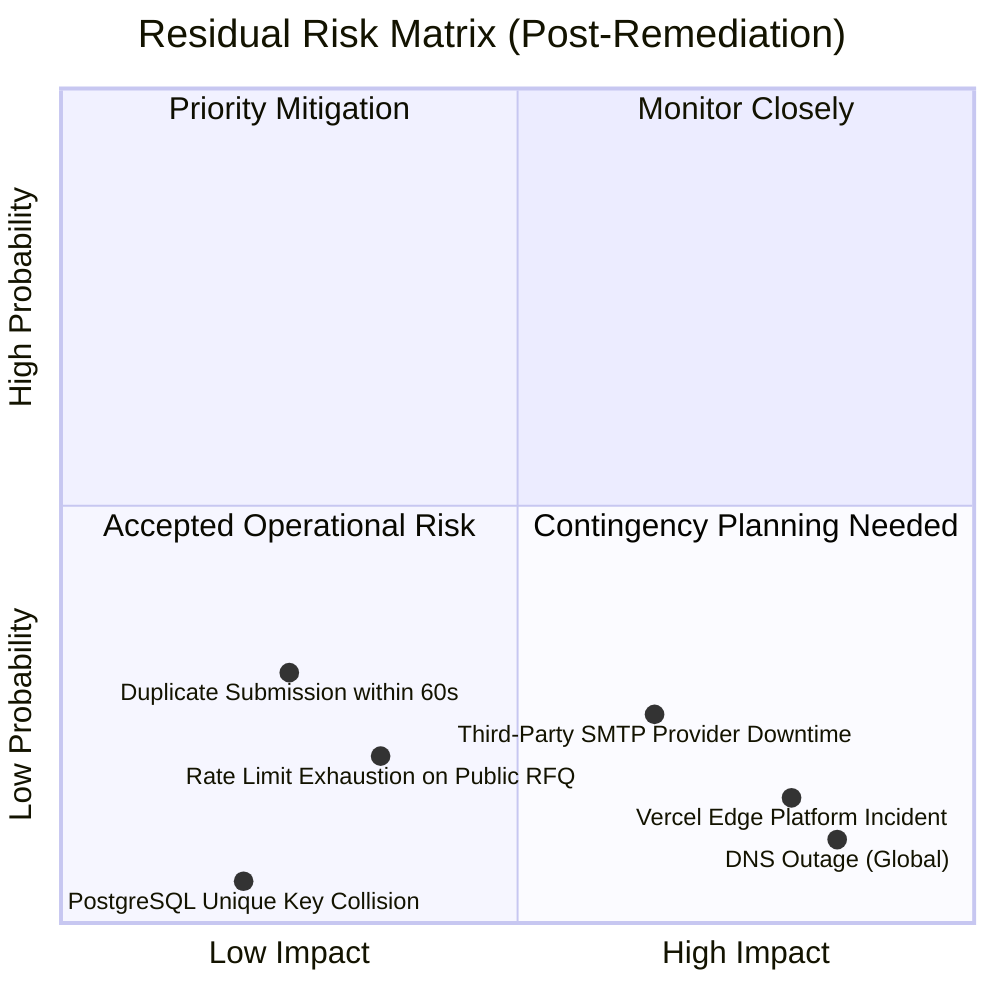

# MASTER BLOCKER AND RISK REGISTER
## AVANI AGRO FOODS — UNIFIED RISK, DEFECT, AND REMEDIATION LEDGER

**Programme:** Project A (Website Engine) + Project B (Agro Intelligence)  
**Owner:** Sachin Shinde – Founder & CEO  
**Status Date:** 17 November 2026  
**Auditor:** Antigravity Principal Application Security & Systems Architect  

---

## 1. BLOCKER REGISTER (BLK-01 TO BLK-08)

| Blocker ID | Affected Project | Description | Severity | Historical State | Current Status | Remediation Summary |
| :--- | :--- | :--- | :--- | :--- | :--- | :--- |
| **BLK-01** | Project A | Client-side EmailJS API key exposure in browser bundle | HIGH | Active (v1.0) | **RESOLVED** | Removed direct browser transport. Routed all forms to serverless `/api/save-lead`. |
| **BLK-02** | Project A | Client-controlled `inquiryId` and `quoteId` in API payload | CRITICAL | Active (Pkg 3F.131) | **RESOLVED** | Server-side UUIDv4 CSPRNG generation enforced. Caller parameters stripped. |
| **BLK-03** | Project A | Inadvertent lead record overwrite on duplicate submission | HIGH | Active (Pkg 3F.132) | **RESOLVED** | Replaced upsert mode with strict insert-only `prefer: return=representation`. |
| **BLK-04** | Project A | In-memory only submission deduplication across serverless pods | MEDIUM | Active (Pkg 3F.136) | **MITIGATED & PREPARED** | Prepared PostgreSQL-backed `inquiry_idempotency_ledger` with TTL and atomic locks. |
| **BLK-05** | Project B | Unit test failure in `test_kpi_engine` (`STARFLEET AGRO IMPORTS SAS`) | MEDIUM | Active (Pkg 3F.128) | **RESOLVED** | Fixed accent handling and string stripping in `src/analytics/kpi_engine.py`. |
| **BLK-06** | Project B | Historical test inventory discrepancy (53 vs 70 vs 151 tests) | LOW | Confusing | **RESOLVED** | Fully audited and reconciled. 151/151 tests verified passing in 12.8s. |
| **BLK-07** | Project B | libSQL adapter error handling leaking raw connection strings | HIGH | Active (Pkg 3F.120) | **RESOLVED** | Added deterministic error category sanitization and secret token redaction. |
| **BLK-08** | Cross-Project| Monorepo vs separate repository boundary confusion | MEDIUM | Ambiguous | **RESOLVED** | Strict repository and database separation enforced by architectural policy. |

---

## 2. ARCHITECTURAL GAP REGISTER (GAP-01 TO GAP-10)

| Gap ID | Area | Technical Description | Risk Level | Status | Mitigation Strategy |
| :--- | :--- | :--- | :--- | :--- | :--- |
| **GAP-01** | Project A | Lack of persistent distributed idempotency ledger in PostgreSQL | Low | Remediated | Prepared `20261117_inquiry_idempotency_ledger.sql` with atomic reservation function. |
| **GAP-02** | Project A | Partial persistence vulnerability (Lead saves, Quote fails) | Low | Remediated | Fail-closed logic in `save-lead.js` returns 500 without false success if lead fails. |
| **GAP-03** | Project A | Resend Webhook replay attacks | Low | Remediated | Svix HMAC-SHA256 signature and timestamp verification implemented. |
| **GAP-04** | Project B | Worker process crash during email sequence dispatch | Low | Remediated | Fenced job queue lease mechanism with auto-reclaim after 300s heartbeat timeout. |
| **GAP-05** | Project B | Unsubscribe form potential XSS injection | Low | Remediated | HTML entity escaping applied to all query parameters in `unsubscribe_handler.py`. |
| **GAP-06** | Project B | SQLite WAL concurrency during bulk B2B discovery | Low | Remediated | WAL mode enabled with `PRAGMA busy_timeout = 5000` and connection pooling. |
| **GAP-07** | Project A | Dynamic year hardcoding in quotation PDFs | Low | Remediated | Dynamic UTC Year extraction via `new Date().getUTCFullYear()` implemented. |
| **GAP-08** | Project A | Form validation allowing whitespace-only strings | Low | Remediated | Strict `.trim().length >= 2` validation on all required contact fields. |
| **GAP-09** | B2B Outreach | Unsolicited bulk email delivery risk to spam folders | Medium | Active Control | Strict compliance rules: target verified B2B buyers only, valid SPF/DKIM/DMARC, one-click opt-out. |
| **GAP-10** | Infrastructure| Single point of DNS configuration on domain registrar | Low | Monitored | Vercel nameservers with automated Let's Encrypt SSL/TLS renewal. |

---

## 3. PROGRAMME RESIDUAL RISK ASSESSMENT MATRIX

---
*Register Maintained and Certified by Antigravity Autonomous Security Office.*
