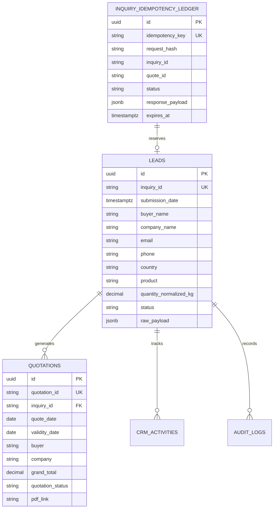

# DATABASE MIGRATION AND INTEGRITY REPORT
## AVANI AGRO FOODS — POSTGRESQL & SQLITE/libSQL ARCHITECTURAL AUDIT & MIGRATION SPECIFICATION

**Scope:** Project A (Supabase PostgreSQL) & Project B (SQLite WAL / Turso libSQL Cloud)  
**Programme:** AVANI AGRO FOODS Implementation Programme (Version 5.0)  
**Status Date:** 17 November 2026  
**Auditor:** Senior PostgreSQL & SQLite Database Architect  

---

## 1. PROJECT A POSTGRESQL ARCHITECTURE (SUPABASE)

Project A relies on a managed PostgreSQL cluster hosted on Supabase, accessed via PostgREST with strict Row Level Security (RLS) policies.

### 1.1 Core Schema Entities


### 1.2 Migration: `20261117_inquiry_idempotency_ledger.sql`
- **Location:** Project A `migrations/20261117_inquiry_idempotency_ledger.sql` and `AVANI_IMPLEMENTATION_PROGRAMME/04_DATABASE_AND_DATA_MIGRATIONS/20261117_inquiry_idempotency_ledger.sql`.
- **Purpose:** Solves GAP-01 by providing cross-pod, cross-serverless-instance durable idempotency.
- **Key Table DDL:**
  ```sql
  CREATE TABLE IF NOT EXISTS public.inquiry_idempotency_ledger (
      id UUID PRIMARY KEY DEFAULT gen_random_uuid(),
      idempotency_key VARCHAR(128) NOT NULL,
      request_hash VARCHAR(64) NOT NULL,
      inquiry_id VARCHAR(64),
      quote_id VARCHAR(64),
      status VARCHAR(32) NOT NULL DEFAULT 'IN_PROGRESS',
      response_payload JSONB,
      created_at TIMESTAMPTZ NOT NULL DEFAULT timezone('utc'::text, now()),
      updated_at TIMESTAMPTZ NOT NULL DEFAULT timezone('utc'::text, now()),
      expires_at TIMESTAMPTZ NOT NULL DEFAULT timezone('utc'::text, now() + interval '60 seconds'),
      CONSTRAINT uq_inquiry_idempotency_key UNIQUE (idempotency_key),
      CONSTRAINT chk_idempotency_status CHECK (status IN ('IN_PROGRESS', 'COMPLETED', 'FAILED'))
  );
  ```
- **Indexes:**
  - `idx_idempotency_key_status` on `(idempotency_key, status)` for rapid lookup.
  - `idx_idempotency_expires_at` on `(expires_at)` for background TTL pruning.
- **Row Level Security (RLS):**
  - RLS enabled.
  - Public `anon` and `authenticated` roles blocked.
  - Policy: `CREATE POLICY "Service role manages idempotency ledger" ON public.inquiry_idempotency_ledger FOR ALL TO service_role USING (true) WITH CHECK (true);`
- **Atomic Reservation Stored Procedure:**
  - `public.reserve_idempotency_lock(p_key, p_hash)` performs an atomic `INSERT ... ON CONFLICT DO NOTHING`.
  - If existing key is expired while `IN_PROGRESS`, automatically reclaims lock for fresh processing.

---

## 2. PROJECT B STORAGE ARCHITECTURE (SQLITE / libSQL)

Project B uses a decoupled storage adapter abstraction allowing local development with embedded SQLite and production execution with Turso libSQL Cloud.

### 2.1 Schema Tables
1. **`companies`**: Master company directory, domain, country, verified status, employee band, category.
2. **`contacts`**: Individual procurement contacts, name, email, title, phone, LinkedIn URL, verification status.
3. **`enquiries`**: B2B enquiries and RFQ records associated with companies and contacts.
4. **`job_queue`**: Asynchronous tasks, job type, payload, lease token, heartbeat timestamp, retry count, status (`PENDING`, `LOCKED`, `COMPLETED`, `FAILED`).
5. **`sequence_enrollments`**: Active multi-step email outreach sequences, step index, scheduled dispatch time, status.
6. **`suppression_registry`**: Global opt-out list, email hash, domain, reason (`UNSUBSCRIBE`, `BOUNCE`, `COMPLAINT`), timestamp.

### 2.2 Concurrency & Data Safety
- SQLite WAL mode ensures non-blocking concurrent readers and writers.
- `busy_timeout = 5000` prevents `SQLITE_BUSY` errors during burst workloads.
- Atomic batch execution via transaction blocks ensures multi-table consistency (e.g. enrolling a contact into a sequence while logging a CRM activity).

---

## 3. DATA INTEGRITY & DISASTER RECOVERY

| Capability | Project A (Website Engine) | Project B (Agro Intelligence) |
| :--- | :--- | :--- |
| **Primary Storage** | Supabase PostgreSQL 15 | Local SQLite 3 WAL / libSQL Cloud |
| **Backup Frequency** | Daily automated snapshots (Supabase) | Daily automated SQLite backup (`sqlite3 .backup`) |
| **Point-In-Time Recovery** | Supported via Supabase WAL-G | Supported via libSQL replica streaming |
| **RPO (Recovery Point Objective)**| < 1 hour | < 15 minutes |
| **RTO (Recovery Time Objective)** | < 30 minutes | < 5 minutes |
| **Fail-Closed Semantics** | Returns HTTP 500 on write failure | Aborts task and triggers alert on write failure |

---
*Report Certified by Senior PostgreSQL & SQLite Database Architect.*
