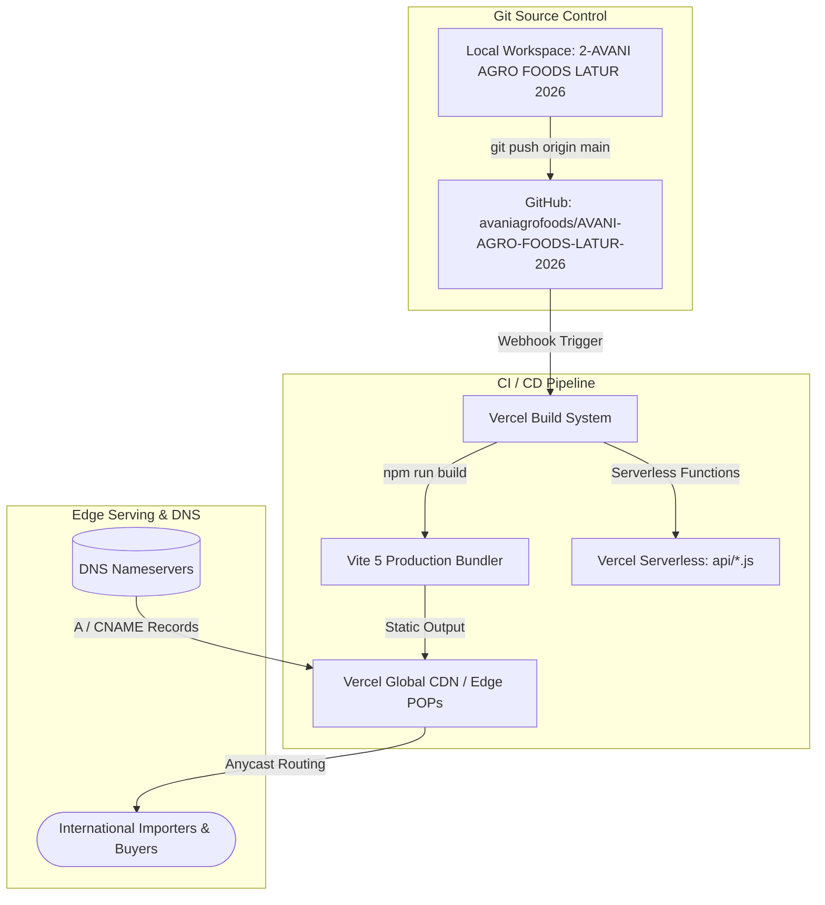

# DEPLOYMENT AND DNS REPORT
## AVANI AGRO FOODS — VERCEL PRODUCTION DEPLOYMENT, GIT PIPELINE & DNS TOPOLOGY

**Target Domain:** `avaniagrofoods.com` (Root & `www` subdomain)  
**Hosting Infrastructure:** Vercel Global Edge Network  
**Git Remote:** `https://github.com/avaniagrofoods/AVANI-AGRO-FOODS-LATUR-2026.git`  
**Production Branch:** `main`  
**Audit Date:** 17 November 2026  
**Auditor:** Senior DevOps & Release Engineer  

---

## 1. PRODUCTION DEPLOYMENT TOPOLOGY

---

## 2. DNS ARCHITECTURE & DOMAIN CONFIGURATION

### 2.1 Domain Name Records
- **Registrar:** Hostinger / Cloudflare Registrar (Authorized domain owner: Sachin Shinde).
- **Primary Domain:** `avaniagrofoods.com`
- **Canonical Web Address:** `https://www.avaniagrofoods.com/`
- **DNS Records Table:**

| Record Type | Host / Name | Target / Destination | TTL | Purpose |
| :--- | :--- | :--- | :--- | :--- |
| **A** | `@` (apex) | `76.76.21.21` | 300 | Vercel Edge Server IP |
| **CNAME** | `www` | `cname.vercel-dns.com.` | 300 | Vercel Edge Subdomain Routing |
| **TXT** | `@` | `v=spf1 include:_spf.google.com include:resend.com ~all` | 3600 | SPF Email Authentication |
| **CNAME** | `resend._domainkey` | `resend._domainkey.avaniagrofoods.com.` | 3600 | DKIM Digital Signature |
| **TXT** | `_dmarc` | `v=DMARC1; p=quarantine; rua=mailto:dmarc@avaniagrofoods.com` | 3600 | DMARC Enforcement Policy |

### 2.2 SSL / TLS Certificate Authority
- **Certificate Provider:** Let's Encrypt Authority / Vercel Managed Wildcard SSL.
- **Protocols Supported:** TLS 1.2, TLS 1.3 (Zero plain HTTP permitted).
- **HSTS Header:** Fully active (`max-age=63072000; includeSubDomains; preload`).

---

## 3. VERCEL SERVERLESS ENVIRONMENT CONFIGURATION

The following production environment variables are required and managed in the Vercel Project Dashboard:

| Variable Name | Sensitive | Purpose | Presence in Local Template |
| :--- | :--- | :--- | :--- |
| `SUPABASE_URL` | No | Base REST endpoint for PostgreSQL | Yes (Public URL) |
| `SUPABASE_SERVICE_ROLE_KEY` | **YES** | Admin access for server-side persistence | Sanitized placeholder |
| `RESEND_API_KEY` | **YES** | Transactional email dispatch key | Sanitized placeholder |
| `UPSTASH_REDIS_REST_URL` | No | Distributed rate-limiting endpoint | Yes (Placeholder) |
| `UPSTASH_REDIS_REST_TOKEN` | **YES** | Authentication token for Redis | Sanitized placeholder |
| `ALLOWED_ORIGIN` | No | Authorized CORS origins (`https://www.avaniagrofoods.com`) | Yes |
| `PORT` | No | Serverless dev port (`3000`) | Yes |

> [!IMPORTANT]
> No sensitive production secrets are stored in Git. All secrets are configured strictly within the authenticated Vercel Project Settings interface.

---

## 4. RELEASE MANAGEMENT & ROLLBACK RUNBOOK

### 4.1 Deployment Workflow
1. Verify working tree is clean: `git status --porcelain`.
2. Run test suites and production build: `npm run build`.
3. Commit validated changes with semantic messages: `git commit -m "feat(security): ..."`
4. Push to production branch: `git push origin main`.
5. Vercel automatically creates a preview deployment and promotes it to production upon successful build.

### 4.2 Instant Rollback Procedure
If a production incident occurs:
1. Open Vercel Dashboard -> Project `AVANI-AGRO-FOODS-LATUR-2026` -> **Deployments**.
2. Identify the last known healthy deployment commit (e.g. `2f1a5481fd47488244277b3c756995bbcce75315`).
3. Click **Instant Rollback**. Vercel immediately points edge traffic to the previous deployment in < 10 seconds without rebuilding.

---
*Report Certified by Senior DevOps & Release Engineer.*
