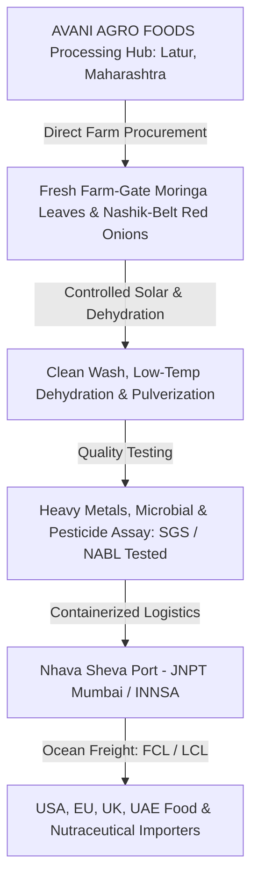
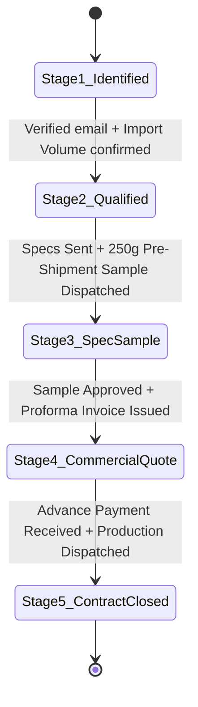

# B2B BUYER ACQUISITION PACKAGE
## AVANI AGRO FOODS — GLOBAL EXPORT COMMERCIAL STRATEGY & BUYER CONVERSION BLUEPRINT

**Manufacturer & Exporter:** AVANI AGRO FOODS  
**Origin:** Latur, Maharashtra, India  
**Founder & Commercial Lead:** Sachin Shinde  
**Target Export Products:** 
1. **Premium Indian Moringa Leaf Powder** (*Moringa Oleifera* — 80–100 Mesh)
2. **Commercial Dehydrated Red Onion Powder** (*Allium Cepa* — 80–100 Mesh)
**Target Geographic Markets:** United States, Germany, Netherlands, United Kingdom, United Arab Emirates  
**Status Date:** 17 November 2026  

---

## 1. STRATEGIC COMMERCIAL OVERVIEW

AVANI AGRO FOODS operates in Maharashtra, the agricultural heartland of India's onion and herbal crop production. Maharashtra produces over 30% of India's onions and maintains optimal semi-arid tropical conditions for cultivating nutrient-dense Moringa oleifera.

### Value Propositions for International Buyers:
1. **Direct Farm-Gate Integration:** No intermediaries; complete batch traceability back to cultivation clusters in Maharashtra.
2. **Quality & Assay Standards:** Low-temperature dehydration preserving chlorophyll/green color (Moringa) and pungent pyruvic acid flavor compounds (Red Onion).
3. **Flexible Incoterms:** FOB Nhava Sheva (JNPT Mumbai) for freight forwarders, or CIF Worldwide (Rotterdam, Hamburg, Felixstowe, Jebel Ali, New York/New Jersey, Long Beach).
4. **Export Packaging:** 20 kg / 25 kg food-grade poly-lined multi-wall paper bags or corrugated export cartons with vacuum-sealed double inner liners.
5. **Regulatory & Export Readiness:** APEDA, Spices Board of India, FSSAI manufacturing license, and standard batch Certificates of Analysis (COA).

---

## 2. PRODUCT SPECIFICATION SHEETS

### 2.1 Premium Indian Moringa Leaf Powder (Export Grade)
- **Botanical Name:** *Moringa Oleifera Lam.*
- **HS Code:** `1211.90.29` (Medicinal & Herbal Plants / Parts)
- **Appearance:** Vibrant, uniform fine green powder (zero brown or scorched flecks).
- **Aroma & Taste:** Characteristic fresh grassy/spinach-like aroma, mild herbaceous taste.
- **Mesh Size:** 80–100 Mesh (Min 95% pass through 80 mesh).
- **Moisture Content:** Max 6.5% – 7.5%.
- **Total Ash:** Max 8.0%.
- **Acid Insoluble Ash:** Max 1.0%.
- **Microbial Standards:**
  - Total Plate Count (TPC): < 10,000 CFU/g
  - Yeast & Mold: < 1,000 CFU/g
  - E. Coli: Absent in 1g
  - Salmonella: Absent in 25g
- **Heavy Metals:** Lead (Pb) < 1.0 ppm, Cadmium (Cd) < 0.2 ppm, Arsenic (As) < 0.5 ppm, Mercury (Hg) < 0.1 ppm (compliant with EU Regulation (EC) No 1881/2006 and US FDA guidelines).
- **Shelf Life:** 24 Months in cool, dry storage (< 25°C).

### 2.2 Commercial Dehydrated Red Onion Powder (Export A-Grade)
- **Botanical Name:** *Allium Cepa L.*
- **HS Code:** `0712.20.00` (Dehydrated Onions, whether or not cut, sliced, broken or in powder)
- **Color:** Natural Pinkish-Red to Reddish-Cream.
- **Flavor & Pungency:** Intensely sharp, sweet-pungent onion flavor (high natural allicin/pyruvate precursors).
- **Particle Size:** 80–100 Mesh fine free-flowing powder (anti-caking free or optional food-grade silicon dioxide on customer spec).
- **Moisture Content:** Max 5.5% – 6.0%.
- **Hot Water Insoluble:** Max 10.0%.
- **Microbial Standards:**
  - Total Plate Count: < 50,000 CFU/g
  - Coliforms: < 100 CFU/g
  - Salmonella: Absent in 25g
- **Packaging:** 20 kg or 25 kg double polyethylene-lined export craft bags.

---

## 3. TARGET BUYER SEGMENTATION & BUYING CRITERIA

| Buyer Persona | Typical Business | Primary Procurement Focus | Typical Order Size |
| :--- | :--- | :--- | :--- |
| **Nutraceutical Formulator** | Dietary supplement capsule/tablet manufacturers, greens powder brands | High ORAC/antioxidant value, microbial sterility, heavy metal compliance | 1,000 kg – 5,000 kg (LCL / 20ft FCL) |
| **Bulk Food Importer / Wholesaler** | International spice & ingredient distributors | Competitive FOB pricing, consistent seasonal supply, container volume | 1 x 20ft FCL (12–14 MT) to 1 x 40ft FCL (24 MT) |
| **Seasoning & Snack Manufacturer** | Instant noodle makers, chip flavor blenders, sauce processors | Consistent pungency, low moisture to prevent caking, solubility | 5,000 kg – 15,000 kg monthly contracts |
| **Private Label Retail Brand** | Health food retail brands, Amazon FBA brand owners | Small batch trial orders, custom packaging (retail pouches / jars) | 500 kg – 2,000 kg |

---

## 4. B2B QUALIFICATION & SALES PIPELINE (STAGES 1 TO 5)

1. **Stage 1: Identification & Enrichment**
   - Source verified importers from US Customs Import manifests, Panjiva, Trademo, Gulfood, Food Ingredients Europe (FiE) directories.
   - Enrich with decision maker: Procurement Director, Sourcing Manager, VP Supply Chain.

2. **Stage 2: Outreach & Value Proposition**
   - Deploy personalized 5-step email sequence. Emphasize direct origin from Maharashtra, COA availability, and prompt FOB Mumbai proforma quotes.

3. **Stage 3: Pre-Shipment Sample Evaluation**
   - Offer 250g–500g DHL/FedEx courier sample with batch Certificate of Analysis for in-house laboratory testing.

4. **Stage 4: Proforma Quotation & Contract**
   - Generate official quotation via `/api/quotation` with Incoterms (FOB / CIF), payment terms (e.g. 30% advance, balance against Bill of Lading copy, or 100% Irrevocable LC at Sight).

5. **Stage 5: Production & Shipment Dispatch**
   - Export container loading from Nhava Sheva (JNPT Mumbai) with phyto-sanitary certificate, COO (Certificate of Origin), and full bill of lading package.

---
*Commercial Package Authored by Sachin Shinde, Founder & CEO, AVANI AGRO FOODS.*
