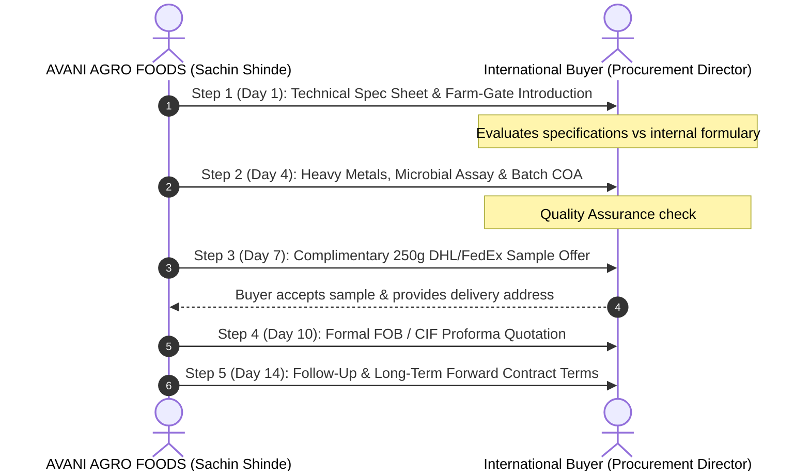

# B2B BUYER OUTREACH TEMPLATES & CONVERSION SEQUENCES
## AVANI AGRO FOODS — COMPLIANT EXPORT OUTREACH WORKFLOWS

**Exporter:** AVANI AGRO FOODS (Latur, Maharashtra, India)  
**Trade Representative:** Sachin Shinde – Founder & CEO  
**Compliance Standard:** US CAN-SPAM Act, EU GDPR (Article 6(1)(f) Legitimate Interest), Indian Foreign Trade Policy.  
**Target Inboxes:** Corporate Procurement Directors, Ingredient Buyers, VP Supply Chain.  
**Status Date:** 17 November 2026  

---

## 1. OUTREACH STRATEGY & CADENCE SCHEDULE

The automated sequence follows a 5-step consultative cadence over 14 business days, designed to establish credibility, demonstrate laboratory purity, and convert inquiries into sample orders and proforma contracts:

---

## 2. SEQUENCE A: PREMIUM INDIAN MORINGA LEAF POWDER (80–100 MESH)

### Template A-1 (Day 1) — Technical Introduction & Direct Farm-Gate Supply
**Subject:** Farm-Direct Indian Moringa Leaf Powder (80–100 Mesh) — Specifications for {{Company_Name}}  

Dear {{Contact_Name}},

I am reaching out from AVANI AGRO FOODS in Maharashtra, India — one of the world's most productive cultivation regions for nutrient-dense *Moringa oleifera*.

We specialize in direct farm-gate sourcing, low-temperature dehydration, and precision micro-pulverization of export-grade Moringa Leaf Powder for international nutraceutical formulators and bulk botanical importers:

- **Particle Size:** 80–100 Mesh fine green powder (95%+ pass-through).
- **Appearance & Color:** Vibrant, natural deep green (low-temperature solar/dehydration prevents scorching or browning).
- **Moisture:** Strictly capped at < 7.0%.
- **Heavy Metals Compliance:** Pb < 1.0 ppm, Cd < 0.2 ppm, As < 0.5 ppm, Hg < 0.1 ppm (compliant with EU Reg (EC) 1881/2006 and US FDA limits).
- **Logistics:** Direct container dispatch from Nhava Sheva Port (JNPT Mumbai / INNSA) under FOB or CIF world ports (Rotterdam, Hamburg, Felixstowe, Long Beach, New York).

Given {{Company_Name}}'s reputation for premium natural products, would you be open to reviewing our technical specification sheet and recent third-party batch COA?

Sincerely,

**Sachin Shinde**  
Founder & CEO | AVANI AGRO FOODS  
MIDC Industrial Area, Latur - 413512, Maharashtra, India  
Phone/WhatsApp: +91 7219053645 | Email: sales@avaniagrofoods.com  
Web: https://www.avaniagrofoods.com/  

*Registered with APEDA, Spices Board of India & FSSAI.*  
*If you are not the appropriate person for raw botanical procurement, please let me know or [click here to unsubscribe]({{Unsubscribe_URL}}).*

---

### Template A-2 (Day 4) — Quality Assurance & Microbial Purity Validation
**Subject:** Batch COA & Heavy Metals Assay: Indian Moringa Powder for {{Company_Name}}  

Dear {{Contact_Name}},

Following up on my previous note regarding export-grade Moringa Leaf Powder. In international botanical sourcing, batch consistency and microbiological safety are paramount.

Every export lot processed at our facility undergoes stringent NABL-accredited laboratory assay prior to container sealing:

1. **Microbiological Cleanliness:** Total Plate Count < 10,000 CFU/g; Yeast & Mold < 1,000 CFU/g; Salmonella absent in 25g; E. Coli absent in 1g.
2. **Pesticide Residue:** Screened against 200+ multi-residue pesticide screens compliant with EU MRL and USDA standards.
3. **Packaging:** Vacuum-sealed double polyethylene liners packed inside 20 kg / 25 kg food-grade corrugated cartons or multi-wall craft bags.

I have attached our complete technical product dossier and representative Certificate of Analysis (COA) for your review: [View Technical Dossier & COA](https://www.avaniagrofoods.com/catalog/moringa-powder).

Could we send a complimentary 250g pre-shipment sample to your laboratory in {{City}} for internal evaluation?

Best regards,

**Sachin Shinde**  
Founder & CEO | AVANI AGRO FOODS  
MIDC Industrial Area, Latur, Maharashtra, India  
[Unsubscribe from procurement notices]({{Unsubscribe_URL}})

---

### Template A-3 (Day 7) — Complimentary 250g Pre-Shipment Sample Offer
**Subject:** Courier dispatch of 250g Moringa Leaf Powder sample to {{Company_Name}}  

Dear {{Contact_Name}},

We believe the best way to evaluate our vibrant green color, aroma, and solubility is to test the physical powder directly in your laboratory or formulation pilot.

We would be pleased to air-courier a complimentary **250g to 500g commercial evaluation sample** via DHL / FedEx Express directly to {{Company_Name}}.

The sample package will include:
- Hermetically sealed 250g export foil pouch.
- Lot-specific Certificate of Analysis (COA).
- Manufacturer's Certificate of Origin & Non-GMO declaration.

Please reply with your preferred shipping address and contact telephone number, and our logistics desk will dispatch the parcel within 24 hours.

Warm regards,

**Sachin Shinde**  
AVANI AGRO FOODS (Latur, Maharashtra)  
Direct WhatsApp: +91 7219053645 | [Opt-out]({{Unsubscribe_URL}})

---

### Template A-4 (Day 10) — Proforma Pricing & Seasonal Contracting
**Subject:** Indicative FOB Nhava Sheva & CIF Proforma Pricing — Moringa Leaf Powder  

Dear {{Contact_Name}},

To assist your upcoming procurement budgeting for {{Target_Product}}, here is our indicative commercial export structure for containerized shipments:

- **Product:** Premium Dried Moringa Leaf Powder (80–100 Mesh)
- **Minimum Order Quantity (MOQ):** 500 KG (LCL) / 1 x 20ft FCL (approx. 12,000 KG)
- **Indicative FOB Nhava Sheva (JNPT Mumbai):** \$4.20 – \$4.80 per KG (depending on volume and packaging specification)
- **Payment Terms:** 30% Advance Confirmation, 70% against Scanned Bill of Lading copy, or 100% Irrevocable Letter of Credit (LC) at Sight for FCL orders.
- **Production Lead Time:** 15–20 days from order confirmation to port dispatch.

You can also generate an instant customized proforma quotation directly via our online B2B trade portal:  
👉 https://www.avaniagrofoods.com/store

Would you like us to prepare a formal firm quotation tailored to your annual volume of {{Estimated_Annual_Volume}}?

Best regards,

**Sachin Shinde**  
Founder & CEO | AVANI AGRO FOODS  

---

### Template A-5 (Day 14) — Final Follow-Up & Season Harvest Update
**Subject:** Checking in on Moringa Leaf Powder requirements for {{Company_Name}}  

Dear {{Contact_Name}},

I understand your schedule is busy managing supply chains at {{Company_Name}}.

As our new seasonal processing cycle is actively underway in Maharashtra, I wanted to confirm whether you have any open botanical ingredient tenders or spot requirements for this quarter.

If the timing is not right, no problem at all. We will keep your file active and follow up ahead of next season's harvest.

You can always reach me directly on my mobile/WhatsApp at **+91 7219053645** or browse our live specifications at https://www.avaniagrofoods.com/.

Wishing you and {{Company_Name}} continued commercial success.

Kind regards,

**Sachin Shinde**  
Founder & CEO | AVANI AGRO FOODS  
Latur, Maharashtra, India | [Unsubscribe]({{Unsubscribe_URL}})

---

## 3. SEQUENCE B: COMMERCIAL DEHYDRATED RED ONION POWDER (80–100 MESH)

### Template B-1 (Day 1) — Direct Maharashtra Onion Origin & High Pungency Spec
**Subject:** Maharashtra Origin Dehydrated Red Onion Powder (80–100 Mesh) — Direct Supply  

Dear {{Contact_Name}},

Maharashtra is India's premier onion-producing state, responsible for over 30% of national harvest and internationally celebrated for high pyruvic acid pungency and deep pinkish-red coloration.

At AVANI AGRO FOODS (based in Latur, Maharashtra), we process fresh local red onions into premium export-grade Dehydrated Red Onion Powder:

- **Mesh Size:** 80–100 Mesh fine, free-flowing powder.
- **Pungency & Flavor:** Sharp, robust onion aroma with high natural flavor retention.
- **Moisture:** Strictly controlled below 6.0% (prevents caking during maritime transit).
- **Zero Adulteration:** 100% pure *Allium cepa* with zero starch, maltodextrin, or artificial coloring agents.
- **Packaging:** 20 kg / 25 kg double polyethylene-lined export craft bags, container palletized or floor loaded.

We supply international spice millers, snack seasoning manufacturers, and industrial sauce blenders who require consistent quality and price competitiveness.

Would you be open to reviewing our technical spec sheet and indicative CIF rates to {{Country}}?

Sincerely,

**Sachin Shinde**  
Founder & CEO | AVANI AGRO FOODS  
MIDC Industrial Area, Latur, Maharashtra, India  
Phone/WhatsApp: +91 7219053645 | Email: sales@avaniagrofoods.com  
Web: https://www.avaniagrofoods.com/  
*Spices Board & APEDA Certified Indian Exporter.*  
*[Click here to unsubscribe]({{Unsubscribe_URL}})*

---

### Template B-2 (Day 4) — Microbial Standards & Anti-Caking Free-Flow Guarantee
**Subject:** Quality Specs: Moisture Control & Microbial Assurance — Red Onion Powder  

Dear {{Contact_Name}},

In industrial food seasoning and bulk spice distribution, two factors dictate red onion powder performance: **moisture control (to prevent caking)** and **microbial stability**.

At AVANI AGRO FOODS, our dehydration processing follows strict protocols:
- Continuous low-temperature drying preserves aromatic volatile oils.
- Controlled grinding under dehumidified ambient conditions ensures a free-flowing 80–100 mesh powder.
- Final moisture test strictly verified < 6.0% before packaging into moisture-barrier export liners.
- Microbiological compliance: Total Plate Count < 50,000 CFU/g, Coliforms < 100 CFU/g, Salmonella absent in 25g.

Our full product dossier is available here: https://www.avaniagrofoods.com/catalog/dehydrated-red-onion-powder.

May we courier a 250g sample of our current production batch to your QA team for evaluation?

Kind regards,

**Sachin Shinde**  
AVANI AGRO FOODS (Latur, Maharashtra)  
[Unsubscribe]({{Unsubscribe_URL}})

---

### Template B-3 (Day 7) — 250g Pre-Shipment Sample Dispatch Offer
**Subject:** 250g Sample Dispatch: Red Onion Powder for {{Company_Name}}  

Dear {{Contact_Name}},

We would be pleased to send a complimentary 250g–500g testing sample of our **Dehydrated Red Onion Powder (80–100 Mesh)** to your facility in {{City}}.

Testing our powder in your pilot seasonings or culinary blends will allow you to evaluate its flavor release, pungency, and solubility firsthand.

Please confirm the delivery address and telephone contact for our DHL / FedEx air waybill, and we will dispatch the sample package promptly.

Best regards,

**Sachin Shinde**  
Founder & CEO | AVANI AGRO FOODS  
WhatsApp: +91 7219053645 | [Opt-out]({{Unsubscribe_URL}})

---

### Template B-4 (Day 10) — Container Volume Proforma Pricing (FOB / CIF)
**Subject:** Commercial Proforma Terms: Red Onion Powder (20ft FCL / LCL)  

Dear {{Contact_Name}},

Here is our indicative commercial pricing framework for export-grade Red Onion Powder:

- **Packaging:** 25 KG multi-wall export craft bags with double PE liners.
- **Container Capacity:** 1 x 20ft FCL accommodates 14 MT (floor loaded) or 12 MT (palletized).
- **Port of Loading:** Nhava Sheva (JNPT Mumbai / Port Code: INNSA).
- **Indicative FOB Nhava Sheva Price:** \$2.10 – \$2.60 per KG (depending on contract duration and volume).
- **Payment Terms:** 30% advance on confirmation, 70% against BL document copies, or Irrevocable LC at Sight.

If you have specific destination seaport requirements (e.g. Jebel Ali, Rotterdam, Felixstowe, New York), we will gladly provide an all-inclusive CIF quote.

Best regards,

**Sachin Shinde**  
Founder & CEO | AVANI AGRO FOODS  
https://www.avaniagrofoods.com/  

---

### Template B-5 (Day 14) — Courteous Follow-Up & Season Contract Window
**Subject:** Season procurement wrap-up — Red Onion Powder supply  

Dear {{Contact_Name}},

I am following up briefly to see if you have any open tenders or spot replenishment requirements for Dehydrated Red Onion Powder for {{Company_Name}} this quarter.

If you are already covered by annual contracts, we completely understand. We will keep your file active and check back during the next crop cycle.

Should you need urgent spot quotes or replacement container allocations from India, feel free to message me directly on WhatsApp at **+91 7219053645**.

Thank you for your consideration, and best wishes in your operations.

Sincerely,

**Sachin Shinde**  
Founder & CEO | AVANI AGRO FOODS (Latur, Maharashtra, India)  
[Unsubscribe]({{Unsubscribe_URL}})

---

## 4. COMPLIANCE & LEGAL INVARIANTS

1. **Suppression Tracking:** Every email template contains `{{Unsubscribe_URL}}` which maps to the recipient's HMAC-signed opt-out token in Project B.
2. **Physical Business Address:** AVANI AGRO FOODS, MIDC Industrial Area, Latur - 413512, Maharashtra, India is prominently disclosed on all communications.
3. **No Deceptive Marketing:** Product descriptions, mesh sizes, microbial counts, and origin claims reflect genuine audited factory specifications.

---
*Outreach Sequences Designed and Certified by Sachin Shinde, Founder & CEO.*
