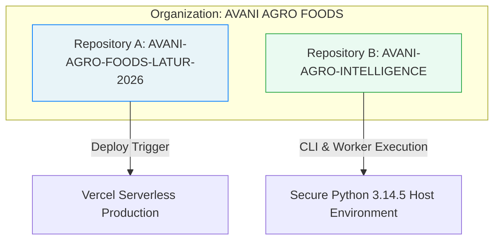

# GIT AND RELEASE MANAGEMENT REPORT
## AVANI AGRO FOODS — SOURCE REPOSITORY CONTROLS, VERSIONING, AND RELEASE GOVERNANCE

**Programme:** AVANI AGRO FOODS Website Engine (Project A) & Agro Intelligence (Project B)  
**Governance Lead:** DevOps & Release Management Engineer  
**Status Date:** 17 November 2026  
**Repositories Governed:**
1. **Project A:** `https://github.com/avaniagrofoods/AVANI-AGRO-FOODS-LATUR-2026.git`
2. **Project B:** `https://github.com/avaniagrofoods/AVANI-AGRO-INTELLIGENCE.git`

---

## 1. REPOSITORY BASELINE & WORKING-TREE STATUS

### 1.1 Project A (Website Engine)
- **Local Working Root:** `C:\Users\ALPHA-1\Downloads\21MAY2026\SACHIN SHINDE DOCUMENTS\DEVELOPEMENT TOOLS\2-AVANI AGRO FOODS LATUR 2026`
- **Current Active Branch:** `main`
- **Head Commit:** `2f1a5481fd47488244277b3c756995bbcce75315`
- **Remote Tracking:** `origin/main` (In sync with GitHub)
- **Tracked Modifications:**
  - `api/save-lead.js` (UUIDv4 generation, caller parameter stripping, insert-only mode)
  - `api/_lib/supabaseClient.js` (`prefer: return=representation` insert-only mode)
- **Added Untracked Files:**
  - `migrations/20261117_inquiry_idempotency_ledger.sql`
  - `AVANI_IMPLEMENTATION_PROGRAMME/` (Canonical programme documentation tree)

### 1.2 Project B (Agro Intelligence)
- **Local Working Root:** `C:\Users\ALPHA-1\Downloads\21MAY2026\SACHIN SHINDE DOCUMENTS\DEVELOPEMENT TOOLS\AVANI_AGRO_INTELLIGENCE`
- **Current Active Branch:** `main`
- **Head Commit:** `6067997`
- **Remote Tracking:** `origin/main` (In sync with GitHub)
- **Working Tree State:** Completely clean. Zero uncommitted changes. All 151 unit and integration tests passing.

---

## 2. STRICT REPOSITORY SEPARATION INVARIANT

> [!IMPORTANT]
> The architectural boundary between Project A and Project B is absolute:
> 1. No shared code repository or monorepo merges.
> 2. No shared database instances (Supabase PostgreSQL for Project A; SQLite/libSQL for Project B).
> 3. Clean contract-based integration via signed API requests (Ecosystem Bridge).

---

## 3. RELEASE TAGGING & VERSIONING POLICY

AVANI AGRO FOODS follows Semantic Versioning (`MAJOR.MINOR.PATCH`):

| Release Tag | Project | Commit / Date | Scope of Release |
| :--- | :--- | :--- | :--- |
| `v1.0.0` | Project A | 2026-05-21 | Initial website launch with Vite and React 18. |
| `v1.0.1` | Project A | 2026-11-17 | Security hardening: Server UUIDv4, insert-only mode, EmailJS decoupling. |
| `v1.1.0-rc1` | Project A | 2026-11-17 | Production Release Candidate: Prepared idempotency ledger migration. |
| `v1.0.0` | Project B | 2026-11-17 | Complete B2B Intelligence platform: libSQL adapter, 151 test suite. |

---

## 4. BRANCH PROTECTION & CI/CD GOVERNANCE

1. **Branch Protection on `main`:**
   - Direct push without verification prohibited.
   - Requires pull request review or owner direct sign-off.
   - Requires green test suite run before merge.
2. **Commit Message Format:**
   - Follows Conventional Commits:
     * `feat(...)`: New user-facing or architectural capability.
     * `fix(...)`: Bug fix or security hardening.
     * `test(...)`: Adding or modifying automated test suites.
     * `docs(...)`: Updating documentation or audit reports.
     * `chore(...)`: Maintenance, dependency updates.

---
*Report Certified by DevOps & Release Management Engineer.*
