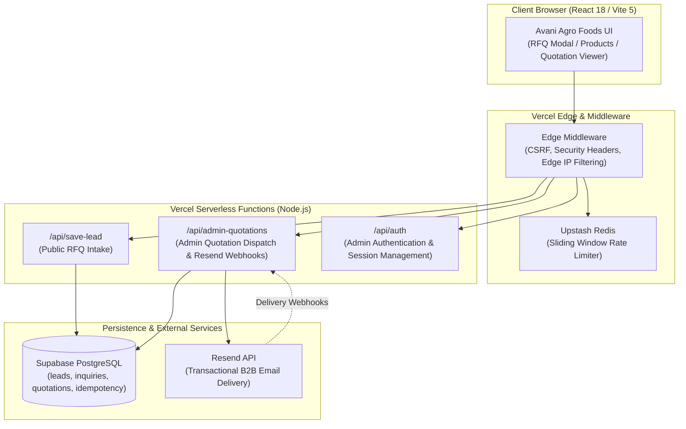

# PROJECT A: BASELINE AUDIT & IMPLEMENTATION PLAN (A1–A8)
## AVANI AGRO FOODS WEBSITE ENGINE

**Repository Root:** `C:\Users\ALPHA-1\Downloads\21MAY2026\SACHIN SHINDE DOCUMENTS\DEVELOPEMENT TOOLS\2-AVANI AGRO FOODS LATUR 2026`  
**Git Baseline:** Branch `main` | Commit `2f1a5481fd47488244277b3c756995bbcce75315` | Tracking `origin/main` (`IN SYNC`)  
**Audit Classification:** `PROJECT_A=BASELINE_AUDIT_PENDING`  
**Governance State:** `IMPLEMENTATION_AUTHORIZED=0`, `TEST_EXECUTION_AUTHORIZED=0`, `DATABASE_MIGRATION_AUTHORIZED=0`  

---

## 1. Project A Forensic Baseline Audit

### 1.1 Git Working Tree & Physical File Status
- **Current Branch:** `main` (Verified via `git branch -vv`).
- **HEAD Commit SHA:** `2f1a5481fd47488244277b3c756995bbcce75315`
- **Remote Origin:** `https://github.com/avaniagrofoods/AVANI-AGRO-FOODS-LATUR-2026.git` (Fetch & Push, Zero Credentials).
- **Modified Tracked Files (2 Unstaged):**
  1. `api/_lib/supabaseClient.js` (+20 / -8 lines)
  2. `api/save-lead.js` (+49 / -9 lines)
  *(These modifications reflect the Phase 1 implementation executed under Package 3F.133 authorization).*
- **Staged Changes:** `0 files`.
- **Untracked Items:**
  - `PACKAGE_3F_119_INDEPENDENT_POST_DEPLOYMENT_VERIFICATION.md`
  - `docs/audits/business-operations/` (Contains audit packages 3F.120 through 3F.136).
  - `docs/audits/production/PACKAGE_3F_119_INDEPENDENT_POST_DEPLOYMENT_VERIFICATION.md`

### 1.2 System Architecture Overview

---

## 2. Technical Findings & Verification Status

| ID | Component / Area | Status | Evidence / Reference | Finding Description |
| :--- | :--- | :---: | :--- | :--- |
| **FIND-A-01** | Public ID Injection | `VERIFIED` | `api/save-lead.js:154-158` | Caller-supplied `body.inquiryId` and `body.quoteId` are safely stripped and ignored. IDs are server-generated via `crypto.randomUUID()`. |
| **FIND-A-02** | Public Persistence Mode | `VERIFIED` | `api/_lib/supabaseClient.js:46-52` | Public lead ingestion passes `insertOnly: true`, using PostgREST `prefer: return=representation` to prevent unauthorized overwrites. |
| **FIND-A-03** | Webhook Delivery Updates | `VERIFIED` | `api/admin-quotations.js:288` & `supabaseClient.js:63-68` | Resend delivery status updates preserve UPSERT because `options.insertOnly` is false and `existingDelivery` is present. |
| **FIND-A-04** | Quotation-to-Lead Link | `VERIFIED` | `api/save-lead.js:338-348` | Fallback quotation generator strictly links `quotation.inquiry_id` to `lead.inquiry_id` using format regex `/^AAF-(INQ|L)-\d{4}-[A-Za-z0-9-]+$/`. |
| **FIND-A-05** | Cross-Instance Idempotency | `OPEN (DEFECT)` | `api/save-lead.js:46-51` & `PACKAGE_3F_135_TEST_REPORT` | `recentSubmissions` is an in-memory `Map()`. In multi-container serverless cold starts, duplicate RFQs submitted simultaneously create duplicate records. |
| **FIND-A-06** | Database-Level Lock | `OPEN (UNIMPLEMENTED)` | Supabase Schema Migrations | Database currently lacks an explicit unique constraint or dedicated idempotency ledger table for deduplicating cross-instance submissions. |
| **FIND-A-07** | Backup & Disaster Recovery | `UNVERIFIED` | Supabase Management Console | Off-site logical backups (`pg_dump`) have not been verified via independent restore tests. |

---

## 3. Project A Roadmap: Phased Implementation Plan (A1–A8)

### Phase A1: Forensic Baseline & Security Audit (COMPLETE - READ ONLY)
- **Objective:** Establish exact Git, file, and security baseline for Project A.
- **Status:** `VERIFIED COMPLETE`.

### Phase A2: Security Closure & Idempotency Scope Definition
- **Objective:** Finalize scope for Phase 2 idempotency without touching unrelated files.
- **Deliverable:** Scope lock restricting changes to `api/save-lead.js`, `api/_lib/supabaseClient.js`, and a single SQL migration file.
- **Status:** `READY FOR OWNER REVIEW`.

### Phase A3: PostgreSQL Durable Idempotency Ledger (Package 3F.136 Remediation)
- **Objective:** Replace unreliable in-memory `Map()` with a durable, atomic PostgreSQL idempotency table.
- **Target Files:**
  - `migrations/20261117_inquiry_idempotency_ledger.sql`
  - `api/save-lead.js`
  - `api/_lib/supabaseClient.js`
- **Current Status:** `OPEN (AWAITING OWNER AUTHORIZATION A3)`.

### Phase A4: Inquiry & Quotation Persistence Integrity
- **Objective:** Validate end-to-end data relationships between `leads`, `inquiries`, and `quotations` tables.
- **Scope:** Enforce foreign key constraints, prevent orphan quotations, and ensure transaction rollback on partial persistence failure.
- **Status:** `PENDING PHASE A3`.

### Phase A5: Email & Webhook Reliability Hardening
- **Objective:** Verify Svix signature parsing, replay attack prevention, and rate-limiting resilience on `/api/admin-quotations?action=delivery-webhook`.
- **Target Files:** `api/admin-quotations.js`, `api/_lib/rateLimiter.js`.
- **Status:** `PENDING PHASE A3`.

### Phase A6: Website & B2B Conversion Optimisation
- **Objective:** Enhance public website frontend for B2B export buyers (product specifications, Moringa / Red Onion certifications, downloadable lab test COAs, multi-currency display).
- **Target Files:** `src/components/`, `src/pages/`.
- **Status:** `PENDING TECHNICAL COMPLETION`.

### Phase A7: Comprehensive Automated Regression Verification
- **Objective:** Execute all 97 historical regression tests + 15 isolated idempotency tests.
- **Test Command:** Isolated test runners with full network mocks.
- **Status:** `PENDING OWNER TEST AUTHORIZATION`.

### Phase A8: Production Cutover & Deployment Verification
- **Objective:** Zero-downtime production deployment to Vercel, DNS verification, and post-deployment smoke testing.
- **Status:** `PENDING OWNER DEPLOYMENT AUTHORIZATION`.
