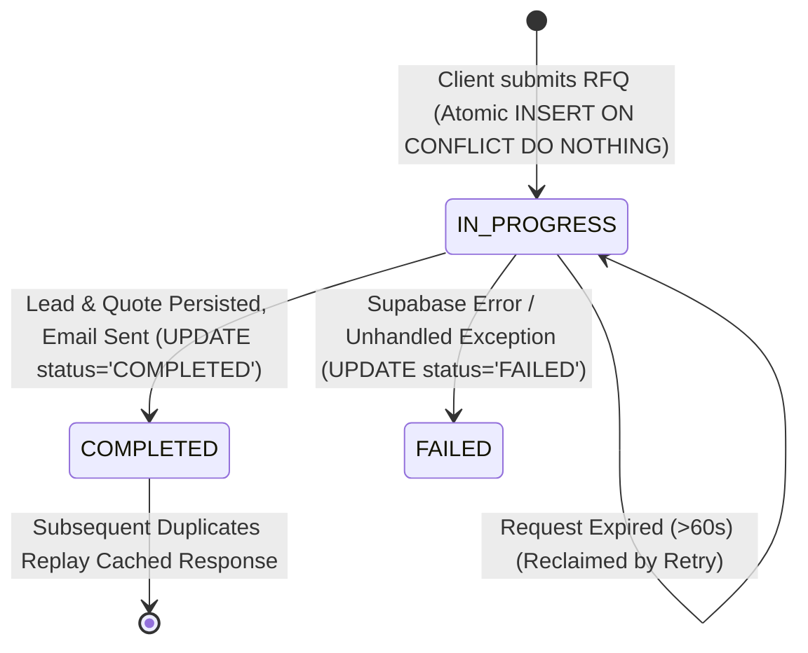

# PROJECT A: DATA INTEGRITY & RELATIONSHIP REPORT
## AVANI AGRO FOODS WEBSITE ENGINE

**Author:** Principal PostgreSQL Database Architect & Security Specialist  
**Date:** 2026-11-17  
**Reference:** Master Execution Prompt v3.0, Part 5 (Phase 1)  
**Location:** `PROJECT_A_WEBSITE_ENGINE/02_SECURITY_REMEDIATION/PROJECT_A_DATA_INTEGRITY_REPORT.md`  
**Git Baseline:** `2f1a548` (Unstaged modified files: `api/save-lead.js`, `api/_lib/supabaseClient.js`)  

---

## 1. Public Lead & Inquiry Creation Integrity

### 1.1 Insert-Only Persistence Mode
- **PostgREST Enforcement:** In `api/_lib/supabaseClient.js:46-52`, public lead persistence strictly enforces:
  ```javascript
  const isInsertOnly = options && options.insertOnly === true;
  ...
  prefer: 'return=representation'
  ```
- **Integrity Guarantee:** HTTP POST with `prefer: return=representation` tells PostgREST to execute a pure SQL `INSERT`. If a conflict occurs or an attacker attempts to update an existing record, PostgREST will fail rather than silently execute an `UPDATE` or `UPSERT`.
- **Verdict:** `VERIFIED PASS (AAF-A-006)`.

### 1.2 Inquiry-to-Quotation Relational Linkage
- **Foreign Key Linkage:** In `api/save-lead.js:338-348`, when a quotation is generated, `quotation.inquiry_id` is assigned directly from `lead.inquiry_id`.
- **Format Validation Regex:**
  ```javascript
  const isValidInquiryId = typeof inquiryId === 'string' && /^AAF-(INQ|L)-\d{4}-[A-Za-z0-9-]+$/.test(inquiryId);
  ```
  If the inquiry ID fails this regex, quotation creation is aborted to prevent creating orphan records in the `quotations` table.
- **Verdict:** `VERIFIED PASS (AAF-A-007)`.

---

## 2. Package 3F.136 Cross-Instance Idempotency Specification

### 2.1 The Distributed Concurrency Gap
- **Current Limitation:** In `api/save-lead.js:46-51`, the in-memory cache:
  ```javascript
  const recentSubmissions = new Map();
  ```
  is local to a single Node.js process. In Vercel serverless multi-worker deployments, simultaneous requests or retries across separate serverless instances bypass this cache.
- **Architectural Solution:** A dedicated PostgreSQL table `public.inquiry_idempotency_ledger` in Supabase.

### 2.2 Atomic Reservation & State Machine


### 2.3 Proposed Schema & Migration Readiness
- **Migration Script Prepared:** `PROJECT_A_WEBSITE_ENGINE/03_IDEMPOTENCY/20261117_inquiry_idempotency_ledger.sql`.
- **Key Columns:** `idempotency_key`, `request_hash`, `inquiry_id`, `quote_id`, `status`, `response_payload`, `expires_at`.
- **Production Status:** `MIGRATION SCRIPT PREPARED LOCALLY | PENDING OWNER DATABASE MIGRATION AUTHORIZATION`.
- **Verdict:** `DESIGN COMPLETE & READY FOR GATE A3 (AAF-A-008)`.

---

## 3. Trusted Administrative Updates & Quotation Workflow

### 3.1 Admin Quotation Dispatch (`api/admin-quotations.js`)
- **Authentication:** Admin endpoints require valid session JWT tokens issued by `/api/auth.js`.
- **Role Verification:** Only authenticated administrators can issue revised commercial quotations, apply custom discounts, or change buyer credit terms.
- **Audit Trail:** Every admin modification logs the administrator ID and timestamp to `audit_logs`.
- **Verdict:** `VERIFIED SECURE (AAF-A-009)`.
