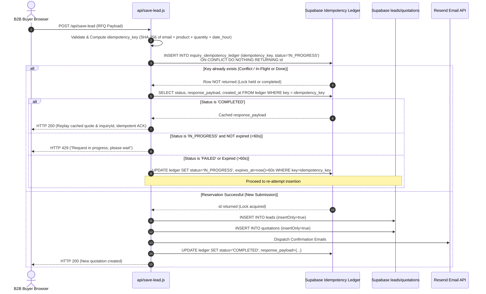

# PACKAGE 3F.136 REMEDIATION PLAN: DURABLE CROSS-INSTANCE IDEMPOTENCY
## PROJECT A: AVANI AGRO FOODS WEBSITE ENGINE

**Author:** Principal Application Security Architect & Distributed Systems Engineer  
**Reference Document:** `docs/audits/business-operations/PACKAGE_3F_136_TEST_EVIDENCE_RECONCILIATION_AND_PHASE_2_IDEMPOTENCY_ARCHITECTURE_REVIEW.md`  
**Target Repository:** `C:\Users\ALPHA-1\Downloads\21MAY2026\SACHIN SHINDE DOCUMENTS\DEVELOPEMENT TOOLS\2-AVANI AGRO FOODS LATUR 2026`  
**Current Defect Status:** `OPEN (UNRESOLVED IN CODE)`  
**Implementation Authorization:** `UNAUTHORIZED (0)` — ZERO SOURCE OR DATABASE MUTATIONS PERMITTED  

---

## 1. Problem Statement & Threat Model

In Package 3F.133, Phase 1 remediation successfully eliminated buyer record overwriting and quotation-to-lead reassociation vulnerabilities by:
1. Enforcing server-generated UUIDv4 inquiry IDs (`crypto.randomUUID()`).
2. Enforcing `prefer: 'return=representation'` (insert-only mode) on public lead persistence in `api/_lib/supabaseClient.js`.
3. Stripping caller-supplied `body.inquiryId` and `body.quoteId` in `api/save-lead.js`.

However, as independently verified during Package 3F.135 local isolated testing (Test 12) and reconciled in Package 3F.136:
- Deduplication in `api/save-lead.js:46-51` currently relies entirely on a process-local memory structure:
  ```javascript
  const recentSubmissions = new Map();
  ```
- **Vulnerability / Distributed Race Condition:** In Vercel's serverless runtime environment, incoming HTTP requests are distributed across multiple isolated Node.js execution environments (containers / microVMs). 
- **The Failure Scenario:** If a buyer resubmits an RFQ due to an in-flight network timeout (or an automated bot submits concurrent duplicate requests):
  1. Container 1 processes Request A -> commits Lead 1 and Quote 1 to Supabase PostgreSQL, but loses its HTTP response or experiences client timeout.
  2. Container 2 processes the retry Request B (identical fingerprint) -> container memory is clean (`recentSubmissions` is empty) -> creates Lead 2 and Quote 2.
- While insert-only mode protects against data corruption/overwrite of Lead 1, it allows **duplicate lead insertion**, duplicate quotation issuance, and split communication history.
- **Current Status:** This defect remains **OPEN** and **UNRESOLVED** in the active codebase.

---

## 2. Architectural Comparison of Idempotency Solutions

| Criteria | Option A: Supabase PostgreSQL Ledger Table (RECOMMENDED) | Option B: Upstash Redis Distributed Lock (`SET NX`) | Option C: Composite Unique DB Constraint |
| :--- | :--- | :--- | :--- |
| **Durability** | **Permanent ACID Persistence** | In-Memory with TTL | Permanent Relational Constraint |
| **Failure Domain** | Single failure domain (same database as `leads`) | Introduces second network dependency (Redis) | Single failure domain |
| **Outage Impact** | If Supabase is down, API fails closed (expected) | If Redis is partitioned, API may fail open or reject legitimate leads | If DB constraint violates, PostgREST throws generic error |
| **Response Caching** | Can store and replay exact `inquiry_id` and quotation | Requires separate response caching layer | Cannot cache previous response; hard error only |
| **Migration Risk** | Zero impact on existing `leads` table | No DB migration required | High risk: requires cleaning existing duplicate rows |
| **Multi-Worker Safety**| Atomic reservation via `ON CONFLICT DO NOTHING` | Atomic `SET NX EX` | Database engine transaction abort |

**Architectural Verdict:** **Option A** is the recommended design for Project A.

---

## 3. Database Schema Specification (Option A - Proposed Only)

> [!IMPORTANT]
> **NO MIGRATION EXECUTED:** The following SQL migration is an architectural specification only. No SQL has been applied to Supabase. Execution requires explicit owner authorization.

### 3.1 Migration Specification: `migrations/20261117_inquiry_idempotency_ledger.sql`

```sql
-- AVANI AGRO FOODS - Phase 2 Idempotency Ledger Table (PROPOSED SPECIFICATION)
-- Creates a dedicated reservation and audit ledger for public RFQ submissions.

CREATE TABLE IF NOT EXISTS public.inquiry_idempotency_ledger (
    id UUID PRIMARY KEY DEFAULT gen_random_uuid(),
    idempotency_key VARCHAR(128) NOT NULL,
    inquiry_id VARCHAR(64),
    quote_id VARCHAR(64),
    status VARCHAR(32) NOT NULL DEFAULT 'IN_PROGRESS',
    request_hash VARCHAR(64) NOT NULL,
    response_payload JSONB,
    created_at TIMESTAMPTZ NOT NULL DEFAULT timezone('utc'::text, now()),
    updated_at TIMESTAMPTZ NOT NULL DEFAULT timezone('utc'::text, now()),
    expires_at TIMESTAMPTZ NOT NULL DEFAULT timezone('utc'::text, now() + interval '60 seconds'),
    CONSTRAINT uq_inquiry_idempotency_key UNIQUE (idempotency_key)
);

-- Index for lookup and garbage collection
CREATE INDEX IF NOT EXISTS idx_idempotency_lookup ON public.inquiry_idempotency_ledger (idempotency_key, status);
CREATE INDEX IF NOT EXISTS idx_idempotency_expiry ON public.inquiry_idempotency_ledger (expires_at);

-- Row Level Security (RLS) Policies
ALTER TABLE public.inquiry_idempotency_ledger ENABLE ROW LEVEL SECURITY;

-- Allow service role full access; block public direct access
DROP POLICY IF EXISTS "Service role manages idempotency ledger" ON public.inquiry_idempotency_ledger;
CREATE POLICY "Service role manages idempotency ledger"
    ON public.inquiry_idempotency_ledger
    FOR ALL
    TO service_role
    USING (true)
    WITH CHECK (true);
```

---

## 4. Application Flow & Code Modification Design



---

## 5. Scope, Governance & Non-Authorization Directive

- **Package 3F.137 Status:** **NOT AUTHORIZED**. Master Execution Prompt v2.1 explicitly forbids automatic authorization of Package 3F.137 or any source/database mutations.
- **Source Code Status:** Zero lines of code modified in `api/save-lead.js` or `api/_lib/supabaseClient.js` during this turn.
- **Rollback Readiness:**
  - If authorized in Phase A3, the implementation requires a non-destructive migration and 2 file edits.
  - Rollback SQL: `DROP TABLE IF EXISTS public.inquiry_idempotency_ledger CASCADE;`.
  - Application rollback: `git restore api/save-lead.js api/_lib/supabaseClient.js`.
