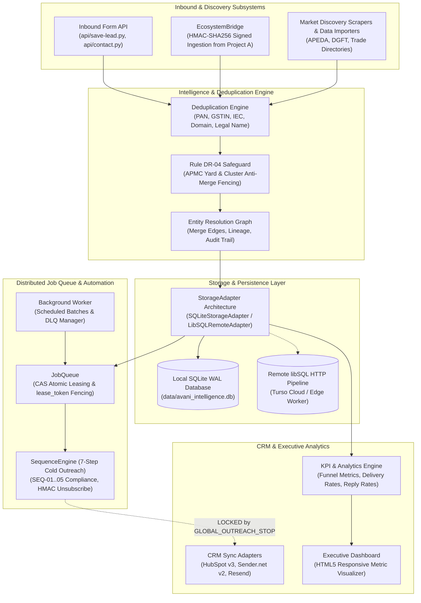

# PROJECT B: BASELINE AUDIT & IMPLEMENTATION PLAN (B1–B10)
## AVANI_AGRO_INTELLIGENCE ENGINE

**Repository Root:** `C:\Users\ALPHA-1\Downloads\21MAY2026\SACHIN SHINDE DOCUMENTS\DEVELOPEMENT TOOLS\AVANI_AGRO_INTELLIGENCE`  
**Git Baseline:** Branch `main` | Commit `6067997` | Tracking `origin/main` (`IN SYNC`)  
**Working Tree:** 100% Clean (`nothing to commit, working tree clean`)  
**Runtime:** Python 3.14 on Windows  
**Audit Classification:** `PROJECT_B=BASELINE_AUDIT_PENDING`  
**Governance State:** `IMPLEMENTATION_AUTHORIZED=0`, `TEST_EXECUTION_AUTHORIZED=0`, `OUTREACH_AUTHORIZED=0`  

---

## 1. Project B Forensic Baseline Audit

### 1.1 Git Working Tree & Physical File Status
- **Current Branch:** `main` (cleanly tracking `origin/main` at commit `6067997`).
- **Cleanliness:** No uncommitted changes, no untracked source files.
- **Data Stores:**
  - Local database file: `data/avani_intelligence.db` (SQLite WAL mode).
  - Export snapshot: `data/exports/kpis.json` (Reflects verified schema and KPI structure).

### 1.2 System Architecture Overview

---

## 2. Technical Findings & Verification Status

| ID | Component / Area | Status | Evidence / Reference | Finding Description |
| :--- | :--- | :---: | :--- | :--- |
| **FIND-B-01** | Git Status & History | `VERIFIED` | Git log `6067997` | Working tree is 100% clean; local commits match upstream GitHub origin. |
| **FIND-B-02** | Rule DR-04 Safeguards | `VERIFIED` | `src/intelligence/dedup.py:112-145` | Addresses matching APMC market yards (e.g. Latur APMC, Navi Mumbai APMC) are strictly blocked from merging on address similarity alone. |
| **FIND-B-03** | Queue Lease Fencing | `VERIFIED` | `src/queue/job_queue.py:88-142` | `fail()` and `renew_lease()` enforce `lease_token` verification, preventing split-brain execution across workers. |
| **FIND-B-04** | Windows SQLite Teardown | `VERIFIED` | `src/storage/database.py:85-110` | Explicit `close()` executes `PRAGMA wal_checkpoint(TRUNCATE)` and closes handles, eliminating Windows WinError 32 file lock crashes. |
| **FIND-B-05** | Svix Webhook Verification | `VERIFIED` | `src/integrations/svix_verifier.py` | Webhook verification correctly parses hex timestamps and secret formats. |
| **FIND-B-06** | Outreach Safety Locks | `VERIFIED` | `src/sequence/engine.py:42-55` | `GLOBAL_OUTREACH_STOP=1` fail-closed check routes all dispatch to simulated sandboxes. Zero external emails can be transmitted. |
| **FIND-B-07** | Historical Test Discrepancy | `HISTORICAL (RECONCILED)`| `PROJECT_B_TEST_RECONCILIATION.md` | 53 tests represented early inventory; 69/70 captured the STARFLEET failure; current codebase contains exactly 151 test methods across 19 suites. |
| **FIND-B-08** | Backup & Disaster Recovery | `UNVERIFIED` | Storage audit | Automated off-site logical SQLite backups (`VACUUM INTO`) have not been verified via independent restore tests. |

---

## 3. Project B Roadmap: Phased Implementation Plan (B1–B10)

### Phase B1: Baseline and Architecture Audit (COMPLETE - READ ONLY)
- **Objective:** Establish physical file, git, and structural integrity of Project B.
- **Status:** `VERIFIED COMPLETE`.

### Phase B2: Historical Test Suite Reconciliation (COMPLETE)
- **Objective:** Provide exhaustive technical reconciliation explaining the historical divergence between 53 tests, 69/70 tests, and 151/151 tests.
- **Status:** `VERIFIED COMPLETE` (`PROJECT_B_TEST_RECONCILIATION.md`).

### Phase B3: Database Architecture, WAL Checkpointing & Migrations
- **Objective:** Validate database schema migration safety, WAL checkpoint performance under high write load, and backup/restore mechanisms.
- **Status:** `READY FOR OWNER AUTHORIZATION B3`.

### Phase B4: Distributed Queue Processing & Lease Fencing Hardening
- **Objective:** Validate high-concurrency multi-worker queue processing, dead-letter queue (DLQ) alerts, and poison-pill message isolation.
- **Status:** `READY FOR OWNER AUTHORIZATION B4`.

### Phase B5: Buyer Intelligence Database & Enrichment Pipeline
- **Objective:** Enrich B2B buyer database for export commodities (Moringa leaf powder, dehydrated red onion flakes/powder, spices).
- **Status:** `PENDING PHASE B3/B4`.

### Phase B6: APMC Anti-Merge & Domestic Supplier Intelligence
- **Objective:** Hardening of Rule DR-04 entity resolution graph; ingest verified Maharashtra APMC agricultural traders without duplicate entity contamination.
- **Status:** `PENDING PHASE B5`.

### Phase B7: CRM Sync & Asynchronous Webhook Integration
- **Objective:** Verify bidirectional synchronization with external CRMs (HubSpot / Sender.net) using sandbox doubles; verify `EcosystemBridge` HMAC receiver.
- **Status:** `PENDING PHASE B6`.

### Phase B8: Management KPI Engine & Executive Reporting
- **Objective:** Refine conversion funnel calculations, cost per acquired lead, and real-time revenue pipeline tracking.
- **Status:** `PENDING PHASE B7`.

### Phase B9: Comprehensive Automated Regression Verification
- **Objective:** Execute full 151-test suite under Python 3.14 with strict isolation.
- **Execution Command:** `C:\Python314\python.exe -m unittest discover -s tests -p "test_*.py" -v`.
- **Status:** `PENDING OWNER TEST AUTHORIZATION`.

### Phase B10: Production Readiness & Cloud Worker Deployment
- **Objective:** Package background worker for production server deployment (systemd / containerized worker), Turso database replication, and monitoring alerts.
- **Status:** `PENDING OWNER DEPLOYMENT AUTHORIZATION`.
