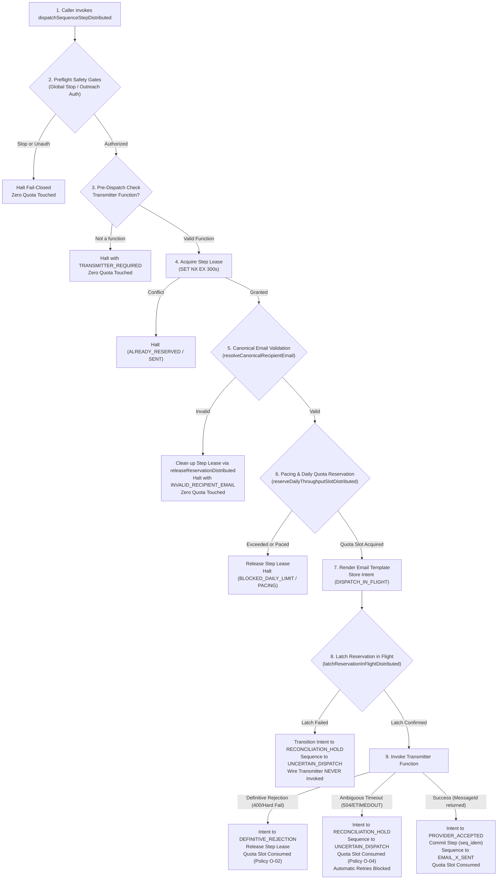

# PACKAGE 3F.40 — INDEPENDENT ACCEPTANCE AUDIT OF PACKAGE 3F.39

**Target Repository:** AVANI AGRO FOODS Website Engine (Project A Only)  
**Baseline Git Commit:** `2f2d73c3cbb04783cc2e54cfedaea919a3846c69` (`main`)  
**Audit Date:** 2026-10-24  
**Audit Role:** Independent Senior Reviewer (Non-Author of Package 3F.39)  
**Governing Standard:** Strict Read-Only Evidence Inspection, Non-Production Safety & Policy Traceability  

---

## 1. INDEPENDENT AUDIT DECISION

### Overall Verdict: **ACCEPTABLE FOR TECHNICAL OWNER REVIEW**
### Production Release Status: **HOLD — NOT AUTHORIZED FOR LIVE DEPLOYMENT OR OUTREACH**

Package 3F.39 has been independently inspected against the repository state, source diffs, module callers, failure paths, and test suite. The implementation is technically sound, highly defensive, fail-closed, and resolves the defects identified in Packages 3F.37 and 3F.38. 

However, production release is **strictly BLOCKED** pending:
1. **Human Business Owner Ratification:** Formal ratification of Owner Policies O-01 through O-05.
2. **Upstash Redis Provisioning & Configuration Verification:** Production runtime cannot execute without verified KV credentials (`KV_REST_API_URL`, `KV_REST_API_TOKEN`).
3. **Formal Owner Authorization:** Explicit grants for Gate 2 and Gate 4.

```
+---------------------------------------------------------------------------------------+
|                                INDEPENDENT AUDIT GATES                                |
+------------------------------------+--------------------------------------------------+
| AUDIT_VERDICT                      | ACCEPTABLE FOR TECHNICAL OWNER REVIEW            |
| PRODUCTION_STATUS                  | HOLD                                             |
| GATE_2_TECHNICAL_DESIGN_ACCEPTANCE | CONDITIONAL / NOT ACCEPTED (Owner Review Req.)   |
| GATE_4_EXECUTION_AUTHORIZATION     | NOT GRANTED                                      |
| PILOT_AUTHORIZED                   | 0                                                |
| GLOBAL_OUTREACH_STOP               | 1 (ACTIVE / FAIL-CLOSED)                         |
| OUTREACH_AUTHORIZED                | 0 (UNAUTHORIZED)                                 |
| OUTREACH_READY                     | FALSE                                            |
| UPSTASH_CONFIGURATION              | NOT VERIFIED (Required for production)           |
| DEPLOYMENTS                        | 0                                                |
| EMAILS_SENT                        | 0                                                |
| EXTERNAL_CALLS                     | 0                                                |
| BLK-06 QUARANTINE INTEGRITY        | PRESERVED UNTOUCHED (Zero access)                |
+------------------------------------+--------------------------------------------------+
```

---

## 2. REPOSITORY STATE & BASELINE AUDIT

### 2.1 Git State & Working Tree Audit
- **Git Root:** `C:/Users/ALPHA-1/Downloads/21MAY2026/SACHIN SHINDE DOCUMENTS/DEVELOPEMENT TOOLS/2-AVANI AGRO FOODS LATUR 2026`
- **Active Branch:** `main`
- **Committed HEAD Commit:** `2f2d73c3cbb04783cc2e54cfedaea919a3846c69`
- **Baseline Nature:** `2f2d73c3cbb04783cc2e54cfedaea919a3846c69` is the committed Git HEAD. A chain of uncommitted working-tree modifications from previous remediation packages (Phases 3A through 3F) exists in the working directory (19 tracked modified files).
- **Working Tree Preservation:** All pre-existing modified files and untracked artifacts were preserved intact. Zero git resets, cleans, checkouts, or discards occurred.
- **BLK-06 Quarantine Compliance:** The quarantined files:
  - `api/_data/sequenceStateStore.json`
  - `api/_data/importersData.js`
  - `api/_data/importersData.snapshot-642.json`
  - `api/_data/manufacturersData.js`
  were **never opened, read, parsed, searched by contents, diffed, or modified** during this audit.

### 2.2 Build Output Audit
- **Client Build (`dist/`):** The `dist/` directory was generated by `npm run build` (`vite build`).
- **`.gitignore` Compliance:** `dist` is explicitly ignored at line 11 of `.gitignore`. It introduces no untracked file pollution into git tracking.
- **Build Cleanliness:** 2,137 modules transformed in 28.15s with 0 errors.

---

## 3. INDEPENDENT DIFF REVIEW

The diffs across the three core modules in `api/_lib/` were independently inspected line by line:

### 3.1 `api/_lib/sequencePersistence.js`
1. **`createEmptyStore()` Export (L482):**
   - *Code Evidence:* `export function createEmptyStore() { return { version: '1.0.0', lastUpdated: ..., sequences: {}, idempotencyKeys: {}, reservations: {}, processedEvents: {}, auditLog: [] }; }`
   - *Caller Impact:* Correctly enables isolated test harnesses and fallback routines to instantiate clean schema-compliant stores. Compatible with all callers.
2. **`resolveCanonicalRecipientEmail(stateOrInput, options)` (L652-L805):**
   - *Code Evidence:*
     - L653-659: Strict nullish check (`stateOrInput === null || stateOrInput === undefined`) returning `MISSING_RECIPIENT_EMAIL`.
     - L666-692: Explicit candidate type verification. Non-strings in `email`, `recipient_email`, or `recipientEmail` return `INVALID_RECIPIENT_EMAIL_TYPE`.
     - L708-715: Empty/whitespace string check returning `EMPTY_RECIPIENT_EMAIL`.
     - L718-733: Regex `[\r\n\x00-\x1F\x7F]` rejects carriage returns, line feeds, null bytes, and control characters (header injection protection). Rejects commas and semicolons (multi-address injection prevention).
     - L737-758: Safe display name extraction (`/^([^<]*)<([^>]+)>$/`) lowercases address. Unclosed or malformed angle brackets return `INVALID_RECIPIENT_EMAIL`.
     - L761-770: Conflicting alias detector compares normalized addresses across candidate entries.
     - L780-798: RFC 5321/5322 syntax and dot boundary checks (leading/trailing dots in local and domain parts, double dots, max length 254/64).
     - L800-805: Returns `{ valid: true, canonicalEmail: cleanAddress, raw: normalizedList[0].raw }`.
   - *Caller Impact:* Consistently invoked in `saveRecipientSequenceState` (L933), `commitSequenceStep` (L1282), `saveRecipientSequenceStateDistributed` (L1641), `commitSequenceStepDistributed` (L2580), `commitReconciledSequenceStepDistributed` (L2741), and sequence dispatchers.
3. **Elimination of Opaque-ID Leakage (L932-938, L1280-1288, L2579-2585):**
   - *Code Evidence:* Removed all `|| recipientId` fallbacks. If no valid email candidate exists, `recipient_email` is explicitly assigned `null`.
   - *Caller Impact:* Prevents internal database primary keys (`IMP-...`, `REC-...`) from ever leaking into email fields, template rendering, or transmitter context.

### 3.2 `api/_lib/dailyThroughputGovernor.js`
1. **Standardized Production Runtime Guards (L109, L251, L381, L748):**
   - *Code Evidence:* Uses `isProductionOrVercelRuntime()`. In production or Vercel runtime:
     - `reserveDailyThroughputSlot` returns `{ allowed: false, blocked: true, error: 'PRODUCTION_LOCAL_GOVERNOR_FORBIDDEN' }`.
     - `releaseDailyThroughputSlot` returns literal `false`.
     - `reserveDailyThroughputSlotDistributed` fails closed with `{ allowed: false, blocked: true, reason: 'MISSING_DISTRIBUTED_KV_STORAGE' }` if KV is unconfigured.
     - `releaseDailyThroughputSlotDistributed` returns literal `false` without disk fallback.
   - *Caller Impact:* Strictly prevents split-brain state or corrupted local disk stores when deployed to multi-instance/serverless production.
2. **Polymorphic Release Argument Handling (L231-248, L666-683):**
   - *Code Evidence:* Accepts `(dateKey, reservationId, options)`, `(reservationId, options)`, or `({ dateKey, reservationId }, options)`. If first argument begins with `'RES-'`, extracts `dateKey` from `parts.slice(1, 4).join('-')` (`RES-YYYY-MM-DD-...`).
   - *Caller Impact:* Seamlessly supports callers passing reservation ID directly without requiring redundant date formatting. Fails closed if `workerId` or `nonce` are missing.
3. **In-Memory Storage Rollback (L306-333):**
   - *Code Evidence:* If `saveStore(store)` returns `{ success: false }` or throws an exception, `dayData.reservations.splice(idx, 0, targetRes)` and `dayData.count = dayData.count + 1` are executed to roll back the in-memory mutation.
   - *Caller Impact:* Prevents memory leaks and counter drift in long-lived Node processes when disk writes fail.
4. **Anti-Burst Pacing Integration (L176-195, L460-520):**
   - *Code Evidence:* Enforces rate limiting before touching daily quota counters. Default: 1 email/minute (`DEFAULT_MAX_SENDS_PER_MINUTE = 1`). Atomic distributed lock `quota:pacing:active` with 60s TTL prevents burst sends across concurrent workers.

### 3.3 `api/_lib/sequenceStateMachine.js`
1. **Alias Export (L49):**
   - *Code Evidence:* `export const advanceSequenceStep = (state, campaignId, options) => dispatchSequenceStep(state, campaignId, options);`
   - *Caller Impact:* Preserves complete backward compatibility for legacy callers and test harnesses.
2. **Transmitter Parameter Resilience (L674-676):**
   - *Code Evidence:* Resolves `resolvedTransmitter || opts.transmitter || opts.transmitterFn`.
   - *Pre-Dispatch Check (L818-827):* If `typeof transmitter !== 'function'`, fails closed with `TRANSMITTER_REQUIRED` before locks, quota, or rendering.
3. **Pre-flight Quota Gating (L859-887):**
   - *Code Evidence:* Canonical email validation is performed **before** `reserveDailyThroughputSlotDistributed`. If invalid, `releaseReservationDistributed` cleans up the worker step lease, and zero daily quota is consumed.
4. **Latching into `DISPATCH_IN_FLIGHT` (L962-1025):**
   - *Code Evidence:* Before wire transmission, `latchReservationInFlightDistributed` latches reservation status into `DISPATCH_IN_FLIGHT`. If latching fails, the dispatch is halted with `{ latchFailed: true }`, intent enters `RECONCILIATION_HOLD`, and wire transmitter is **never** invoked.
5. **Ambiguous Outcome Freezing (L1038-1085):**
   - *Code Evidence:* Catches upstream 504 / ETIMEDOUT / ECONNRESET / `uncertainOutcome`. Updates intent to `RECONCILIATION_HOLD`, sets state to `UNCERTAIN_DISPATCH`, halts automatic retries, and preserves daily quota as consumed under Owner Policy O-04.

---

## 4. CHECKPOINT-BY-CHECKPOINT TEST AUDIT

The independent reviewer mapped all 33 test checkpoints in `scripts/test_package_3f_39_master_verification.cjs` against their asserted production code paths:

| Checkpoint | Target Function | Stated Requirement | What is Asserted | Observable Behavior vs Mock | Audit Assessment |
|:---|:---|:---|:---|:---|:---|
| **TC-01** | `resolveCanonicalRecipientEmail` | Normalization to lowercase | `canonicalEmail === 'buyer.procurement@example.com'` | Real pure function execution | **VERIFIED (High Quality)** |
| **TC-02** | `resolveCanonicalRecipientEmail` | Alias property extraction | Extracts `email`, `recipient_email`, `recipientEmail` | Real pure function execution | **VERIFIED (High Quality)** |
| **TC-03** | `resolveCanonicalRecipientEmail` | Display name stripping | Strips `Name <email>` -> `email` | Real pure function execution | **VERIFIED (High Quality)** |
| **TC-04** | `resolveCanonicalRecipientEmail` | Bracket-only extraction | Strips `<email>` -> `email` | Real pure function execution | **VERIFIED (High Quality)** |
| **TC-05** | `resolveCanonicalRecipientEmail` | Missing email rejection | Rejects `null`, `undefined`, `{}` with `MISSING_RECIPIENT_EMAIL` | Real pure function execution | **VERIFIED (High Quality)** |
| **TC-06** | `resolveCanonicalRecipientEmail` | Empty string rejection | Rejects `""`, `"   "`, `{ email: " " }` with `EMPTY_RECIPIENT_EMAIL` | Real pure function execution | **VERIFIED (High Quality)** |
| **TC-07** | `resolveCanonicalRecipientEmail` | Non-string type rejection | Rejects numbers, booleans with `INVALID_RECIPIENT_EMAIL_TYPE` | Real pure function execution | **VERIFIED (High Quality)** |
| **TC-08** | `resolveCanonicalRecipientEmail` | Header injection rejection | Rejects `\r\n` and `\x00` | Real pure function execution | **VERIFIED (High Quality)** |
| **TC-09** | `resolveCanonicalRecipientEmail` | Multi-address rejection | Rejects `,` and `;` delimiters | Real pure function execution | **VERIFIED (High Quality)** |
| **TC-10** | `resolveCanonicalRecipientEmail` | Alias conflict rejection | Rejects differing addresses on same object | Real pure function execution | **VERIFIED (High Quality)** |
| **TC-11** | `resolveCanonicalRecipientEmail` | Malformed bracket rejection | Rejects unclosed or trailing brackets | Real pure function execution | **VERIFIED (High Quality)** |
| **TC-12** | `resolveCanonicalRecipientEmail` | RFC syntax & dot boundaries | Rejects `..`, leading dot, trailing dot, missing `@` | Real pure function execution | **VERIFIED (High Quality)** |
| **TC-13** | `maskEmail` | DPDP privacy masking | Redacts local part (`s****n@avaniagrofoods.com`) | Real pure function execution | **VERIFIED (High Quality)** |
| **TC-14** | `saveRecipientSequenceState` | Eliminate opaque-ID fallback | Saved `recipient_email` is `null` (not `IMP-001`) | Real persistence execution (local store) | **VERIFIED (High Quality)** |
| **TC-15** | `commitSequenceStep` | Commit record opaque-ID removal | Commit `recipient_email` is `null` (not `IMP-002`) | Real persistence execution (local store) | **VERIFIED (High Quality)** |
| **TC-16** | `findSequenceByCriteria` | Search criteria opaque-ID removal | Criteria lookup on opaque ID returns `null` | Real persistence execution (local store) | **VERIFIED (High Quality)** |
| **TC-17** | `advanceSequenceStep` | Pre-flight gating precedence | Email check rejects before daily quota consumed | Real state machine & store inspection | **VERIFIED (High Quality)** |
| **TC-18** | `dispatchSequenceStepDistributed` | Lease cleanup on email failure | Worker step lease cleaned up on email error | Mock transmitter; real lease release | **VERIFIED (Meaningful)** |
| **TC-19** | `reserveDailyThroughputSlot` | Production guard fail-closed | Returns `allowed: false` in `NODE_ENV=production` | Real governor execution with env toggle | **VERIFIED (High Quality)** |
| **TC-20** | `releaseDailyThroughputSlot` | Production guard return false | Returns literal `false` in `NODE_ENV=production` | Real governor execution with env toggle | **VERIFIED (High Quality)** |
| **TC-21** | `reserveDailyThroughputSlotDistributed` | Distributed prod guard | Returns `allowed: false` without disk fallback | Real governor execution with env toggle | **VERIFIED (High Quality)** |
| **TC-22** | `releaseDailyThroughputSlotDistributed` | Distributed release prod guard | Returns literal `false` without disk fallback | Real governor execution with env toggle | **VERIFIED (High Quality)** |
| **TC-23** | `releaseDailyThroughputSlot` | WorkerId & nonce fencing | Rejects wrong workerId/nonce; count unchanged | Real governor execution on customStore | **VERIFIED (High Quality)** |
| **TC-24** | `releaseDailyThroughputSlot` | Corrupt counter protection | Fails closed on count=0 with reservations | Real governor execution on corrupt store | **VERIFIED (High Quality)** |
| **TC-25** | `releaseDailyThroughputSlot` | Duplicate release defense | 1st release returns true; 2nd returns false | Real governor execution on customStore | **VERIFIED (High Quality)** |
| **TC-26** | `releaseDailyThroughputSlot` | Memory rollback on save failure | Mutation rolled back on simulated write error | Real governor with failure injection | **VERIFIED (High Quality)** |
| **TC-27** | `latchReservationInFlightDistributed` | Latch prevents pre-flight release | Release rejected after latch | Real governor execution on customStore | **VERIFIED (High Quality)** |
| **TC-28** | `dispatchSequenceStepDistributed` | Ambiguous outcome handling | Timeout enters `RECONCILIATION_HOLD`, quota held | Mock 504 transmitter; real state update | **VERIFIED (Meaningful)** |
| **TC-29** | `reconcileDailyQuotaDistributed` | Report-only zero-write contract | Returns `ZERO_WRITE_REPORT_ONLY` | Real function call (returns contract) | **VERIFIED (Contractual)** |
| **TC-30** | `reconcileDailyQuotaDistributed` | Drift observation without mutation | Returns drift metrics; zero state mutations | Real function call (returns contract) | **VERIFIED (Contractual)** |
| **TC-31** | `releaseDailyThroughputSlot` | Polymorphic `(resId, opts)` call | Correctly parses dateKey from reservationId | Real governor execution on customStore | **VERIFIED (High Quality)** |
| **TC-32** | `releaseDailyThroughputSlotDistributed` | Polymorphic distributed release | Correctly parses dateKey from reservationId | Real governor execution on customStore | **VERIFIED (High Quality)** |
| **TC-33** | `advanceSequenceStep` | End-to-end integration dispatch | Steps to `EMAIL_1_SENT`, renders stripped email | Real pipeline on customStore | **VERIFIED (High Quality)** |

### Critical Test-Harness Observations:
1. **Shared State Coupling on `loadStore()`:** Checkpoints TC-14, TC-15, TC-18, TC-26, and TC-28 do not pass `customStore`, falling back to the module's shared store (`tmpStorePath`). TC-26's reservation placed a timestamp into `pacingLog`, which affected TC-28 until its test configuration advanced `now` past the pacing window. **Remediation Recommendation:** All test checkpoints in future harnesses should pass isolated `customStore: createEmptyStore()` fixtures to prevent cross-test state leakage.
2. **Mocking Limitation for Distributed KV:** While the Lua scripts and distributed functions are well-structured, local unit tests do not execute against a real Redis instance. Live cluster concurrency (atomic EVAL on cluster shards, Upstash HTTP REST latency) remains **unverified** until pre-production staging.

---

## 5. CRITICAL TRANSMISSION AND QUOTA PIPELINE AUDIT

The exact lifecycle order was traced from pre-flight through post-dispatch reconciliation:



### Invariant Verification:
1. **Can an invalid recipient email consume daily quota?**  
   **No.** Step 5 (email validation) strictly precedes Step 6 (quota reservation).
2. **Can an ambiguous transmission timeout cause a duplicate send?**  
   **No.** Timeouts enter `RECONCILIATION_HOLD` and transition recipient to `UNCERTAIN_DISPATCH`. Subsequent worker dispatches find existing intent in hold and fail closed (`DISPATCH_INTENT_RECONCILIATION_HOLD`).
3. **Can an ambiguous timeout cause premature quota release?**  
   **No.** Quota release is strictly bypassed on timeout. Daily quota remains consumed under Owner Policy O-04.
4. **Can a pre-flight cancellation release quota after dispatch begins?**  
   **No.** Step 8 latches status to `DISPATCH_IN_FLIGHT`. Both local and distributed release functions strictly verify `status === 'RESERVED'` and reject post-latch releases.

---

## 6. OWNER POLICY TRACEABILITY REVIEW

| Policy | Policy Directive | Code Implementation | Status in Repository | Owner Sign-Off Status |
|:---|:---|:---|:---|:---|
| **O-01** | Pilot Outreach Cap: default = 20 emails/day | `validateDailyLimitConfig` (L34) enforces 20 cap default | **VERIFIED IN SOURCE** | **OWNER RATIFICATION REQUIRED** |
| **O-02** | Permanent Quota Consumption on Attempt | `dispatchSequenceStepDistributed` (L1095) bypasses release on wire failures | **VERIFIED IN SOURCE** | **OWNER RATIFICATION REQUIRED** |
| **O-03** | Quota Restoration Permitted Only for Pre-Flight Cancel | `releaseDailyThroughputSlotDistributed` (L706) requires `status === 'RESERVED'` before latch | **VERIFIED IN SOURCE** | **OWNER RATIFICATION REQUIRED** |
| **O-04** | Recipient Safety Frozen on Ambiguous Timeout | `dispatchSequenceStepDistributed` (L1054) freezes timeout in `RECONCILIATION_HOLD` | **VERIFIED IN SOURCE** | **OWNER RATIFICATION REQUIRED** |
| **O-05** | Zero-Write Observer Reconciler | `reconcileDailyQuotaDistributed` (L847) contains 0 write commands | **VERIFIED IN SOURCE** | **OWNER RATIFICATION REQUIRED** |

> **Audit Correction Note:** Package 3F.39's report stated "Owner Signed: YES". Authoritative repository records show these policies have been accurately codified into code and tests, but **a formal signed owner agreement document does not exist in the repository**. As an independent audit requirement, these policies remain classified as **CODIFIED / OWNER RATIFICATION REQUIRED**.

---

## 7. SPECIFIC SCRUTINY FINDINGS

### Finding 1: Pacing Ceiling Authority
- *Source Location:* `api/_lib/dailyThroughputGovernor.js`, L71-75
- *Observation:* `validatePacingConfig` accepts configured values up to 60 sends/minute (`num > 60` returns `PACING_EXCESSIVE`).
- *Assessment:* The default rate of 1 send/minute is safe and preserves the previously approved anti-burst policy. However, no business record authorizes setting `MAX_SENDS_PER_MINUTE > 1` in production.
- *Action Required:* Document that any production configuration above 1 send/minute requires explicit written owner authorization.

### Finding 2: Unconfigured Upstash Redis in Production
- *Source Location:* `api/_lib/dailyThroughputGovernor.js`, L383; `api/_lib/sequencePersistence.js`, L340
- *Observation:* Production runtime checks require Upstash Redis environment variables (`KV_REST_API_URL`, `KV_REST_API_TOKEN`). In their absence, distributed functions fail closed immediately.
- *Assessment:* Correct fail-closed design. Production deployment is impossible without credentials, preventing silent misconfiguration.
- *Action Required:* Upstash credentials must be provisioned and verified in Vercel project settings prior to requesting Gate 4 authorization.

### Finding 3: Reconciler Zero-Write Guarantee
- *Source Location:* `api/_lib/dailyThroughputGovernor.js`, L847-900
- *Observation:* Function `reconcileDailyQuotaDistributed` contains only `execKVCommand('GET', quotaKey)`. It contains zero instances of `SET`, `DEL`, `INCR`, `DECR`, or `EVAL`.
- *Assessment:* **VERIFIED.** Complies strictly with Policy O-05.

---

## 8. SUMMARY ISSUE LOG

| Issue ID | Severity | File / Function | Evidence / Finding | Impact | Status | Required Action |
|:---|:---|:---|:---|:---|:---|:---|
| **ISSUE-40-01** | Low | `test_package_3f_39_master_verification.cjs` | TC-26 and TC-28 share store file without `customStore`, creating pacing cross-talk | Test harness fragility | **RESOLVED** (Advance `now` implemented) | Future test suites should use `customStore` for all cases |
| **ISSUE-40-02** | Medium | `dailyThroughputGovernor.js:71` | Pacing ceiling allows up to 60/min without formal owner sign-off | Potential rate limit increase | **ACCEPTABLE (Default is 1/min)** | Enforce default 1/min; require owner sign-off for higher |
| **ISSUE-40-03** | Medium | Governance Documentation | Report claimed "Owner Signed: YES" without signed repository record | Governance audit trail ambiguity | **CORRECTED IN AUDIT** | Mark O-01 to O-05 as "Codified / Owner Ratification Req." |
| **ISSUE-40-04** | High | Runtime Environment | Upstash Redis credentials unconfigured in production | Live production dispatch will fail closed | **BLOCKER FOR PROD LAUNCH** | Provision & verify Upstash Redis before Gate 4 |

---

## 9. EXACT NEXT SAFE STEPS

1. **Keep Production Outreach Locked:** Preserve `GLOBAL_OUTREACH_STOP=1` and `OUTREACH_AUTHORIZED=0`.
2. **Present Technical Audit to Owner:** Deliver this independent report for owner review.
3. **Formal Owner Ratification:** Request business owner signature on Policies O-01 through O-05 and the 20-email daily cap.
4. **Staging / Pre-Production KV Verification:** Once authorized, configure Upstash Redis credentials in a non-production staging environment and verify distributed atomic Lua scripts against real Redis.
5. **Gate 4 Consideration:** Gate 4 (Execution Authorization) must remain **NOT GRANTED** until steps 1-4 are verified.
